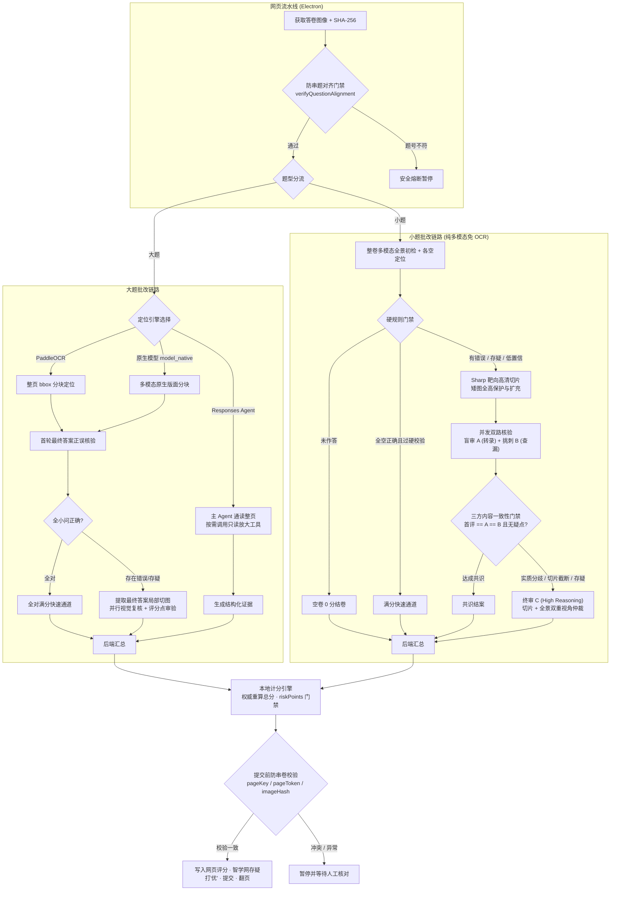

# 衡准 · EquiGrade

> 高中物理手写作答 AI 全自动改卷工作台 —— 稳定分阶段 / Responses Agent 大题链路 · 纯多模态小题切片双路核验 · 评分标准版本化 · 网页阅卷流水线


一个面向高中物理大题与小题的**本地单机**全自动改卷工作台（Windows 优先）。系统集成了高精度视觉多模态大模型、本地防御性计分引擎以及内嵌网页阅卷流水线，支持智学网与睿芽云两大主流平台，实现“确认答卷 → 图像提取 → 智能批改 → 防串卷/防串题校验 → 写入网页分数 → 提交与回读验证 → 进入下一份”的无人值守全流程闭环。

---

## ✨ 核心特性

### 1. 大题批改双链路
- **稳定分阶段链路（默认）**：
  - **双定位引擎支持**：支持在 **PaddleOCR 服务**（整页 bbox 分块定位）与 **模型原生视觉分块（`model_native`）** 间自由切换。选用 `model_native` 时由多模态模型原生分析版面并输出作答区域，**完全免除外部 PaddleOCR 与 Token 依赖**。
  - **首轮最终答案核验与快速通道**：首轮由教师模型核验各小问最终答案与手写坐标，提取最终答案局部高清切图作为审计证据；若各小问首轮全部正确，直接触发**全对满分快速通道**，无需第二轮模型调用。
  - **按需局部审验**：存在真实错误、疑似作答或图像不可用的小问，携带高清局部切图按需并行进入视觉复核和评分点审验。
- **Responses Agent 链路（手动启用）**：
  - 仅用于大题、完全不调用 PaddleOCR。
  - 由单一主 Agent 直接通读整页 WebP q90 视觉输入，按需调用只读局部放大工具（最多 3 轮、6 个唯一区域），输出严格结构化判定。

### 2. 小题纯多模态切片与正交双路核验链路
- **全景初检与各空定位**：**完全免除外部 PaddleOCR**，由多模态模型原生全卷全景初检并输出各空归一化坐标。
- **本地硬规则快速通道**：整卷未作答直接触发**空卷 0 分快速通道**；全空判定正确且通过本地单选域与有效数字硬校验，直接触发**满分快速通道**（无需二次模型调用）。
- **靶向高清大图切片（Sharp）**：针对存疑或错误小空，自动执行靶向切片提取（具备矮图横条全高保护与向右扩充冗余，杜绝切片截断）。
- **正交双路盲审 A 与挑刺 B 并发核验**：
  - **盲审 A**：纯客观字符转录，不透露参考答案；
  - **挑刺 B**：对照参考答案与首评严格查找漏洞、有效数字与涂改；
  - **内容一致性门禁**：首评、A、B 三方识别内容完全一致且无未消解疑点时共识结案。
- **深度终审 C（High Reasoning Effort）**：凡首评有作答但切片判空、三者实质不一致、B 存疑或切片截断时，强制调起终审 C（同时输入切片与全卷全景）进行多视角仲裁。
- **结构化高风险门禁**：模型显式返回枚举 `riskPoints`（`'无' | '切片截断' | '严重涂改' | '符号歧义' | '字迹难辨'`），彻底废除自然语言正则；模型明确返回 `['无']` 且置信度达标（≥ 0.90）时不触发复核；明确指出确凿风险点或状态存疑时才标记 `needs_review` 并联动智学网勾选“优”标签提交。

### 3. 本地计分权威与安全兜底
- **后端重算总分权威**：教师评语由后端根据已校验结果生成；无论大题还是小题，最终总分**始终由后端计分引擎按当前评分标准权威重算**，绝不采信模型返回的总分。
- **无条件满分保障**：教师模型判定最终答案 `correct` 的小问**无条件满分**，过程评分点仍审验但不得降低得分。
- **复核安全不阻断**：`unreadable` / `uncertain` / 审验冲突时标记 `needs_review`，在确保有合法有效分数的前提下流水线继续写分提交，同时将试卷推入人工复核队列；写分或提交失败时坚决暂停。

### 4. 网页阅卷自动化与防事故门禁
- **防串题门禁（`verifyQuestionAlignment`）**：流水线启动与答卷提取前，强制校验网页题目（如第 13 题）与评分标准题号一致性，题号不一致时坚决阻断或安全暂停。
- **防串卷三重门禁（`assertSameAnswer`）**：提交前强制比对 `pageKey`、`pageToken` 与 `imageHash`，任何一步身份或图片哈希不符坚决拒绝写分与提交。
- **多平台适配**：内置智学网（默认）与睿芽云适配器，支持在设置页一键切换，并内置本地模拟演练站（`/zhixue-mock`、`/mock-grading`）。

---

## 🧠 系统工作流



---

## 🧰 技术栈

| 模块 | 技术与版本 | 说明 |
|---|---|---|
| **桌面客户端** | Electron 43 · React 19 · Vite 7 | 跨平台桌面外壳、嵌入式阅卷网页视图、会话隔离与持久化 |
| **本地服务** | Express 5 · Node.js 22 · TypeScript 5.8 (strict) | 统一批改编排、任务流水线、AES-256-GCM 本地加密存储 |
| **图像与多模态** | Sharp 0.35 · WebP q90 | 局部切片靶向裁剪、全高横条冗余扩展、自适应灰度增强 |
| **安全与防御** | zod 4 · timingSafeEqual · URL 白名单校验 | 严格 JSON Schema 输出校验、API Token 防时序攻击 |
| **排版与测试** | KaTeX · Vitest 3.2 | 物理公式标准化渲染、438 项单元与集成测试全量回归 |

---

## 🚀 快速开始

### 1. 环境准备
- 操作系统：Windows 10 / 11（x64）
- 运行时：Node.js 20+（推荐 Node.js 22+）

### 2. 本地安装与开发
```powershell
# 1. 安装依赖
npm install

# 2. 启动桌面端调试环境（自动构建 preload 并拉起 Electron 工作台）
npm run electron:dev

# 3. 运行全量测试回归套件（438 个测试全部通过）
npm test
```

### 3. 构建 Windows 安装包
```powershell
npm run package:win
```
构建产物输出于 `release/` 目录，生成 `衡准自动改卷工作台-x.x.x-Windows-x64-Setup.exe` 安装文件。

---

## ⚙️ 模型配置与约定

1. **接口协议**：
   - 兼容 OpenAI 标准 `POST {baseUrl}/chat/completions`，请求头携带 `Authorization: Bearer {apiKey}`。
   - Base URL 请确保指向带有 `/v1` 的路径（如 `https://api.example.com/v1`）。
   - Responses Agent 链路强制使用 `POST {baseUrl}/responses`（固定 `store:false`）。
2. **结构化输出约束**：
   - 所有模型调用均强制启用严格服务端 `json_schema` 模式，禁止降级到宽松 JSON。
   - 物理公式要求模型直接输出标准 LaTeX，反斜杠由系统在 `JSON.parse` 前自动转义修复。
3. **免 OCR 极简部署**：
   - 小题批改链路默认**完全无需配置 PaddleOCR**，直接使用多模态视觉模型即可全功能运行。
   - 大题批改链路在模型设置中将定位引擎选择为“模型原生视觉分块（`model_native`）”，亦可完全免去 PaddleOCR 配置，仅凭单一多模态大模型 Key 即可完成批改。

---

## 🧪 本地模拟与演练

系统内置了与真实阅卷平台结构完全一致的本地演练入口，无需连接外网即可完整测试流水线：
- `/zhixue-mock`：智学网适配器仿真测试页。真实复刻了保存前下一份禁用约束、小问评分框、存疑打“优”勾选以及批量翻页控制。
- `/mock-grading`：通用阅卷适配器测试页，支持导入自定义 JSON 测试试卷。

---

## 🔐 隐私与安全承诺

- **本地单机存储**：API 密钥经 AES-256-GCM 算法加密仅存放于本机 `.data/` 目录；学生答卷、批改历史与日志绝不上传任何未授权的第三方第三方平台。
- **敏感数据脱敏**：系统日志严格过滤 API Key、Token 以及答卷原始 Base64 数据，仅保留 SHA-256 哈希与调试摘要信息。
- **接口安全校验**：所有内部 API 均基于本地随机生成的 `HENGZHUN_API_TOKEN` 进行常数时间（`timingSafeEqual`）鉴权。

---

## 📄 开源许可

本项目采用 [MIT License](./LICENSE) 授权。
