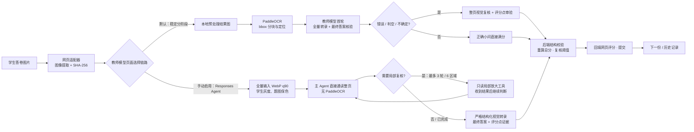
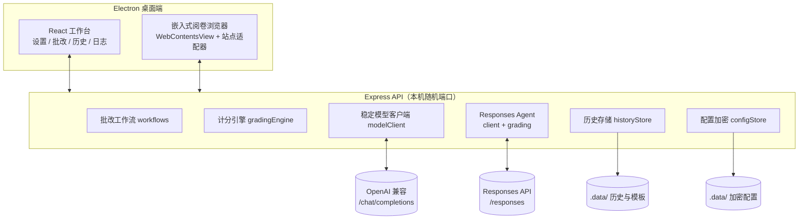

# 衡准 · EquiGrade

> 高中物理手写作答 AI 自动改卷工作台 —— 稳定分阶段链路 / Responses Agent 视觉链路 · 评分标准版本化 · 网页阅卷流水线


一个面向高中物理大题的**本地单机**自动改卷工作台（Windows 优先）。默认使用稳定分阶段链路：PaddleOCR 提供整页 bbox 分块和定位索引，教师多模态模型首轮只确认各小问最终答案；判错、判空或不确定的小问再按需并行进入局部视觉复核和评分点审验。也可以在教师模型页面手动切换到新的 Responses Agent 大题链路：该链路完全禁用 PaddleOCR，由单一主 Agent 直接查看整页图，并按需调用只读局部放大工具。无论哪条链路，教师评语由后端根据已校验结果生成，后端只做结构校验、按当前评分标准版本**重算总分**与复核阈值判定，不信任模型返回的总分。桌面端（Electron）右侧内嵌目标阅卷网页，自动写分、提交并翻页。

## ✨ 核心特性

- **大题分阶段批改链**：首轮教师模型只做最终答案正误判定；答案正确的小问由本地计分引擎直接满分，错误、判空或不确定的小问才进入两条并行复核支路
- **OCR 分块转录链**：PaddleOCR 提供全量 bbox 分块与预处理答卷图定位，教师模型负责逐块检验和矫正；每次调用的 OCR 区块、模型路由和复核结果均进入审计记录
- **Responses Agent 大题链路（手动启用）**：完全不调用 PaddleOCR；主 Agent 先通读整页，再按需并行请求 `inspect_page_tiles` / `inspect_page_region` 局部图，最多 3 轮、6 个唯一区域，收到工具结果后继续输出严格结构化判定
- **双层结构化审验**：逐小问给出 `correct / incorrect / missing / uncertain` 权威结论，逐评分点给出 `satisfied / not_satisfied / not_present / unreadable` 审验结论，并附可定位证据
- **后端重算总分**：模型总分不作为依据；判定 `correct` 的小问直接满分，过程审验仍完整执行但**不得降低**该小问得分
- **复核安全**：`unreadable` / `uncertain` / 审验冲突 → 标记 `needs_review` 并保存原因、置信度和卷面证据；只要分数有效仍继续写分/提交，历史记录中检查并支持回批；写分或提交失败才暂停，复核不提高 `maximumPossibleScore`
- **评分标准版本化**：确认后保存为本机模板，后续修改生成新版本；历史重判使用当次评分标准快照，不覆盖旧结果
- **网页阅卷流水线**：睿芽云 / 智学网 / 通用站点适配器自动提取答卷图（含 SVG→PNG 与 SHA-256）、回填分数、提交、翻页；`pageKey` / `pageToken` / `imageHash` 三重防串卷
- **答卷图本地增强**：稳定链路沿用同尺寸预处理答卷图；Responses Agent 链路的所有模型输入（学生整页、题目/参考答案、网格图和局部图）统一编码为 WebP q90，学生答卷执行灰度增强，题目/参考答案保留颜色；原始答卷仍只用于本地坐标、哈希和历史保存
- **批改产物缓存**：每次写入历史的批改会在项目根目录 `grading-artifacts/<结果ID>/` 保存预处理答卷图、题目/参考图片、稳定链路的 PaddleOCR 原始 JSONL/Markdown/bbox 或 Agent 链路的 WebP 网格/局部图、完整 Responses output item、模型调用记录、批改上下文和最终结果；历史记录详情中可直接点击打开。API 进程从其他目录启动时可用 `HENGZHUN_GRADING_ARTIFACT_DIR` 指定绝对目录。
- **本地优先与隐私**：API Key AES-256-GCM 加密、日志脱敏、数据全部存本机 `.data/`
- **严格的模型调用**：批改请求强制使用服务端校验的 `json_schema`，拒绝降级到 `json_object` 或纯 JSON；稳定链路使用现有 `/chat/completions`，Responses Agent 必须使用 `/responses` 且固定 `store:false`，不依赖 `previous_response_id`；`finish_reason=length` 或 Responses `incomplete/failed` 整次作废；模型直接输出标准 LaTeX，JSON 反斜杠由本地解析器修复，历史 `[[LATEX_BS]]` 仅作兼容读取
## 🧠 工作原理



流程要点：

1. 在教师模型页面选择大题批改链路：稳定分阶段（默认，使用 `/chat/completions` 与 PaddleOCR）或 Responses Agent（手动启用，强制 `/responses`、完全不使用 PaddleOCR）；分别配置各自参数
2. 上传/粘贴题目、参考答案与评分标准；文本模型生成结构化评分规则草稿，人工检查后保存
3. 上传学生作答图片并开始批改。稳定链路本地生成同尺寸预处理结果，随后 PaddleOCR 只处理该结果并生成整页区块、bbox 和辅助 Markdown；Agent 链路则把学生整页、题目/参考答案和定位网格统一转成 WebP q90，学生图灰度增强、题图保色，不发起 PaddleOCR
4. 稳定链路首轮核验全量 OCR 区块转录并确认每个小问最终答案；错误、判空或不确定的小问同时发起最终答案视觉复核和评分点审验。Agent 链路由主 Agent 先通读整页、生成视觉转录和答案判定，看不清时批量调用只读局部工具，收到局部图后继续判断；工具结果、完整 output item、坐标和图片哈希都进入审计
5. 后端校验所有小问、评分点与证据引用，**重新计算总分**并标记整卷复核风险（默认阈值 2 分）
6. 批改完成后将本次中间产物和结果写入 `grading-artifacts/<结果ID>/`，历史详情提供文件链接；随后结果回填阅卷网页并提交，历史记录支持用当次评分标准重新批改旧结果（新增版本，不覆盖）

Responses Agent 采用 `store:false`，不依赖云端 `previous_response_id`；本地保存每轮完整 output item、工具调用、WebP q90 局部图、哈希和结果版本，供历史详情逐轮回放。连接测试、模拟页面和本地 Vitest 只能验证协议与安全边界；真实 Responses 服务的视觉能力/并发额度，以及登录后的睿芽云或智学网站点写分、提交、回读和翻页，仍需人工验收。

**过程评分边界**：严格区分 `formula / substitution / result / text` 证据对象。等价判断只适用于学生卷面实际写出的表达——公式点必须有明确可见的符号关系证明，不能根据数字算式反推学生未写出的公式；代入点必须有正确关系与数据对应；结果错误不能反向证明此前步骤正确。该边界由教师模型依据预处理后的整页答卷图自主判断，不使用本地字符串/公式模板匹配。

旧版“学生答卷批改方式”入口已下线。当前大题默认使用“预处理答卷图 → PaddleOCR 分块定位 → 教师模型全量转录与首轮答案核验 → 按需并行整页视觉复核与评分点审验 → 后端计分”的稳定链路；教师模型页面另提供显眼的 Responses Agent 切换入口。Agent 链路固定为“WebP q90 输入 → 主 Agent 整页视觉转录 → 按需局部工具 → 严格结构化结果 → 后端计分”，不派生子 Agent、不回退稳定链路。严格 `json_schema`、后端计分权威、复核不阻断和完整审计是两条链路的共同约束。

### 小题独立批改链路

评分标准创建时可选择“大题”或“小题”。小题固定执行 `预处理答卷图 → PaddleOCR-VL → GPT 作答还原 → GPT 小题评分 → 本地计分引擎`；作答还原阶段只接收预处理答卷图和 OCR Markdown，评分阶段只接收题目/参考答案、评分标准和还原结果，不再次接收答卷图。PaddleOCR 返回的完整 JSONL 与合并后的 Markdown 会随 `GradingResult.ocrAudit` 保存到历史记录；OCR、还原或评分失败不会生成可提交分数。

PaddleOCR 配置可通过环境变量或本机未跟踪文件提供访问令牌，仓库不保存令牌：

```powershell
$env:PADDLEOCR_MCP_AISTUDIO_ACCESS_TOKEN = "[REDACTED_SECRET]"
$env:PADDLEOCR_JOB_URL = "https://paddleocr.aistudio-app.com/api/v2/ocr/jobs" # 可选
$env:PADDLEOCR_MODEL = "PaddleOCR-VL-1.6" # 可选
```

本机临时联调也可以将新的 Token 单独保存到 `.data/paddleocr.token`；环境变量优先。该文件已被 Git 忽略，不能提交、打印或写入日志。聊天中暴露过的 Token 不得继续使用。

轮询间隔和总超时分别由 `PADDLEOCR_POLL_INTERVAL_MS`（默认 5000）与 `PADDLEOCR_TIMEOUT_MS`（默认 600000）控制。小题历史重判会读取原答卷和当次评分标准快照，新增结果记录并保留原 OCR 审计。

## 🏗 架构



## 🧰 技术栈

| 层 | 技术 |
|---|---|
| 桌面端 | Electron 43 · React 19 · Vite 7 |
| 后端 | Express 5 · TypeScript 5.8（strict） |
| 校验/安全 | zod · AES-256-GCM · timingSafeEqual · URL 结构校验与代理传输 |
| 渲染 | KaTeX（确定性渲染，本地 JSON 反斜杠修复与历史 token 兼容） |
| 测试 | Vitest（241 个用例通过，1 个跳过） |

## 🚀 快速开始

前置：Node.js 20+（建议 22+）

```powershell
npm install
npm run dev          # 开发（API 随机端口 + Vite 5173）
npm run electron:dev # 桌面端开发（构建 preload + 启动 Electron）
npm run package:win  # 生成 Windows x64 安装包（release\）
```

浏览器直接访问服务仅显示桌面端引导页，并保留两个测试入口：`/mock-grading`（通用 `data-grading-*` 控件测试页）与 `/zhixue-mock`（智学网专用适配器模拟页）。服务端首次启动会自动保存一份"模拟网页改卷演练 · 圆周运动"测试模板。
## 🧪 本地测试站

`/zhixue-mock` 复刻智学网真实结构：`#topicImgContent`、`.scorearea`、`#txt_marking_all`、`#bnt_save`、`a[title="上一份"]` 与 `a[title="下一份"]`。模拟页提供 JSON 测试用例导入/导出、答卷图像、最终总分保存、自动提交开关、上一份/下一份与任务量进度；为对齐真实智学网约束，**当前份未保存时"下一份"按钮禁用**，不连接真实智学网。

睿芽云真实阅卷页使用专用适配器：学生原图从 `#imageFullScreen` 提取，最终总分写入 `#panelKey` 下按页面顺序排列的可见总分框（单题页为一个，多评页为每个小题一个），提交按钮为 `#submitMark`。多评页只有在模型小问数量、各小问满分及得分之和均与网页一致时才会写分；睿芽云没有独立的下一份按钮，提交成功后由页面自动装载下一份；跨域作答图只允许来自 `alimarkpic.onlyets.com` 与睿芽云扫描图 OSS 桶 `ry-mark.oss-cn-beijing.aliyuncs.com`（v6 阅卷页实际使用）。系统默认启动阅卷地址为智学网，并在设置页提供一键切换智学网与睿芽云选项；自定义真实地址仍会妥善保留。

JSON 测试用例格式如下，`imageDataUrl` 可选；没有图片时会根据 `lines` 生成本地 SVG 答卷图：

```json
{
  "version": 1,
  "site": "zhixue-mock",
  "cases": [
    {
      "id": "student-001",
      "studentId": "学生 001",
      "label": "学生 001",
      "questionLabel": "第 16 题 · 竖直圆轨道综合题",
      "maxScore": 18,
      "lines": ["(1) mgh=1/2 mvB²，vB=8.0 m/s", "NB-mg=mvB²/R，NB=45 N", "(2) vC²=32，NC=15 N>0，能通过C点", "(3) NC=0，hmin=5R/2=2.00 m", "(4) cosθ=-5/6，θ=146.4°，v=2.58 m/s"]
    }
  ]
}
```

Electron 流水线的"测试任务"默认打开 `/zhixue-mock`，可直接验证智学网专用适配器的页面检查、图像提取、总分写入、提交确认与翻页逻辑；`/mock-grading` 入口保留用于通用适配器回归测试。适配器从 `img.currentSrc`、`src`、`srcset`、`data-src`、`data-original`、CSS `background-image` 或 `canvas` 提取作答图，计算 SHA-256 后调用 `/api/pipeline/grade`，服务端会重新计算上传图片哈希并校验；异常跳过当前答卷并记录原因，连续 3 次失败后暂停。
## 📁 项目结构

```
src/       前端。DesktopApp.tsx 桌面端主应用
server/    后端。index.ts 路由 · workflows.ts 批改工作流 · gradingEngine.ts 计分引擎
           · modelClient.ts 稳定模型调用 · responsesAgentClient.ts / responsesAgentGrading.ts
           · gradingArtifactStore.ts · historyStore.ts · configStore.ts · schemas.ts
electron/  主进程。main.ts · browserSession.ts（嵌入式浏览器+会话持久化）
           · plugins/（runtime.ts 状态机 · ruiyaAdapter.ts · zhixueAdapter.ts · genericAdapter.ts · imageExtractor.ts）
shared/    前后端共享。types.ts · electron.ts IPC 契约 · uiConstants.ts · pipelineEvents.ts
.data/     运行时数据（模板/历史/加密配置）——绝不提交
```

## ✅ 质量保障

```powershell
npx tsc -b                            # 前端 + shared 类型检查
npx tsc -p tsconfig.server.json       # server 类型检查
npx tsc -p tsconfig.electron.json     # electron 类型检查
npx vitest run                        # 218 个用例全量回归
```

## 📖 开发规范

完整约定见 [AGENTS.md](./AGENTS.md)。核心设计不变量（改代码前必读）：

- **计分权威**：教师模型判定 `correct` 的小问无条件满分，过程审验不得降低得分；总分一律由后端重算
- **复核安全**：`unreadable` / `uncertain` / 审验冲突 → 标记待复核但不阻断有效分数写入；记录中保留低置信证据并支持回批，写分/提交异常仍暂停
- **防串卷**：`pageKey` / `pageToken` / `imageHash` 三重校验是写分/提交前的最后同步防线，不得绕过
- **共享单点维护**：主题/字体/白名单/图片上限 → `shared/uiConstants.ts`；事件文案 → `shared/pipelineEvents.ts`；IPC 契约 → `shared/electron.ts`

## 🔐 隐私与安全

- API Key 使用 AES-256-GCM 加密存于本机 `.data/`，不会返回浏览器或写入 Git
- 所有 `/api` 请求校验 `HENGZHUN_API_TOKEN`（timingSafeEqual）；外呼服务地址只做 URL 结构校验，不限制 DNS 解析到的网络范围
- 日志不记录 Key 与图片 Base64，图片只记录类型、字节数与 SHA-256 摘要；模型调用细节记录在 `.data/history.json` 的 `records[].modelCalls`，每次批改的可查看文件另存于 `grading-artifacts/<结果ID>/`

## 🔌 模型服务约定

- `POST {baseUrl}/chat/completions`，`Authorization: Bearer {apiKey}`
- 图片使用 `messages[].content[].image_url`；多模态连接测试使用标准 `128x128` RGB PNG，避免部分供应商拒绝 `1x1` 灰度透明图
- 稳定分阶段链路继续使用 `/chat/completions`；Responses Agent 链路必须使用 `POST {baseUrl}/responses`，请求固定 `store:false`、`parallel_tool_calls:true`、严格 `text.format.type=json_schema` 和 `include:["reasoning.encrypted_content"]`，本地手动续接完整 output item 与 `function_call_output.call_id`，不发送 `previous_response_id`，也不回退到 Chat Completions
- Responses Agent v1 只有一个主 Agent，不派发子 Agent；只允许 `inspect_page_tiles` 与 `inspect_page_region` 两个只读局部图工具，共享最多 3 个工具轮次和 6 个唯一归一化区域。`backendGuardrailsEnabled` 默认开启时，`incorrect`/`missing` 即使分数可解析也会进入 `needs_review` 并可触发独立审验；关闭只取消这项额外升级，证据来源、坐标和后端计分安全校验仍强制执行
- Responses Agent 所有送入模型的图片均为 WebP q90；学生答卷执行灰度增强，题目/参考答案保留颜色，工具返回的局部图和网格索引图也使用 WebP q90。原始答卷图不替换、不上传到云端审计目录
- 模型和 PaddleOCR 外呼默认直连本地智联服务；只有显式设置 `HENGZHUN_MODEL_PROXY_URL` 为 HTTP(S) 地址时才使用代理，设置为 `direct` 或空值也会直连。目标地址不再做 DNS/IP 私网范围限制，但仍必须是 HTTP(S) URL 且不能在目标地址中嵌入用户名或密码；模型服务 Base URL 通常应填写包含 `/v1` 的地址
- 外呼请求带有 `Accept: application/json` 和透明的 `User-Agent`；若模型域名由 Cloudflare Access 保护，可配置 `HENGZHUN_CLOUDFLARE_ACCESS_HOST`、`HENGZHUN_CLOUDFLARE_ACCESS_CLIENT_ID`、`HENGZHUN_CLOUDFLARE_ACCESS_CLIENT_SECRET`，程序只会对精确匹配的模型 hostname 发送官方 Service Token headers
- 普通 Cloudflare WAF/Managed Challenge 返回 403 HTML 时，不能靠伪造浏览器 headers 或 `cf_clearance` Cookie 合法解决；应让站点管理员放行 `/v1/chat/completions` 或配置 Access Service Token
- 大题稳定链路首轮调用 `large_question_answer_triage` 返回全量 OCR 区块转录、区块定位和最终答案状态；需要复核的小问并行调用 `large_question_visual_review` 与 `large_question_point_review`，后者始终在整页预处理答卷图范围内审验，`block_id` 只作定位辅助。Responses Agent 链路则由 `large_question_responses_agent` 主 Agent 直接输出视觉转录、最终答案和评分点证据，教师评语由后端生成，最终总分由本地计分引擎重算
- 教师模型页面可在显眼的大题链路入口切换稳定分阶段或 Responses Agent，并只展示当前链路的相关参数；稳定链路配置 PaddleOCR 与分阶段路由，Agent 配置 Responses API、轮次/区域额度、只读工具策略和可选独立高风险审验。两套配置分别保存，切换不会清空另一套
- 结构化输出始终使用严格 `json_schema`；HTTP 200 但不符合业务 JSON 契约时仅在同一严格模式重试，服务拒绝 Schema 时直接记录失败，不切换到弱约束格式
- `finish_reason=length` 视为截断并整次作废；模型返回的标准 LaTeX 由本地解析器在 JSON 解析前修复，历史 `[[LATEX_BS]]` 记录继续兼容
- 推理强度（低/中/高）作为 `reasoning_effort` 传给最终答案判定与过程审验；服务端不支持时应保持"默认"

## ❓ 常见问题

- **模型调用报 `Unexpected token: '<'`**：Base URL 缺 `/v1` 路径，请求命中网站首页 HTML；改为 `https://host/v1`
- **接入真实阅卷网站**：在 `electron/plugins/` 增加并注册站点适配器即可，评分模板、模型调用与本地历史数据无需改动；当前默认目标为智学网，支持一键切换睿芽云，另保留通用适配器
- **没有模型密钥**：点击"载入演示批次"可直接查看完整工作流与报告界面

## 📄 许可

本项目采用 [MIT License](./LICENSE) 开源（Copyright © 2026 Hengzhun）。

> 提示：本仓库不附带任何模型服务额度；API Key、Base URL 与答卷数据均由使用者自行配置与保管。
