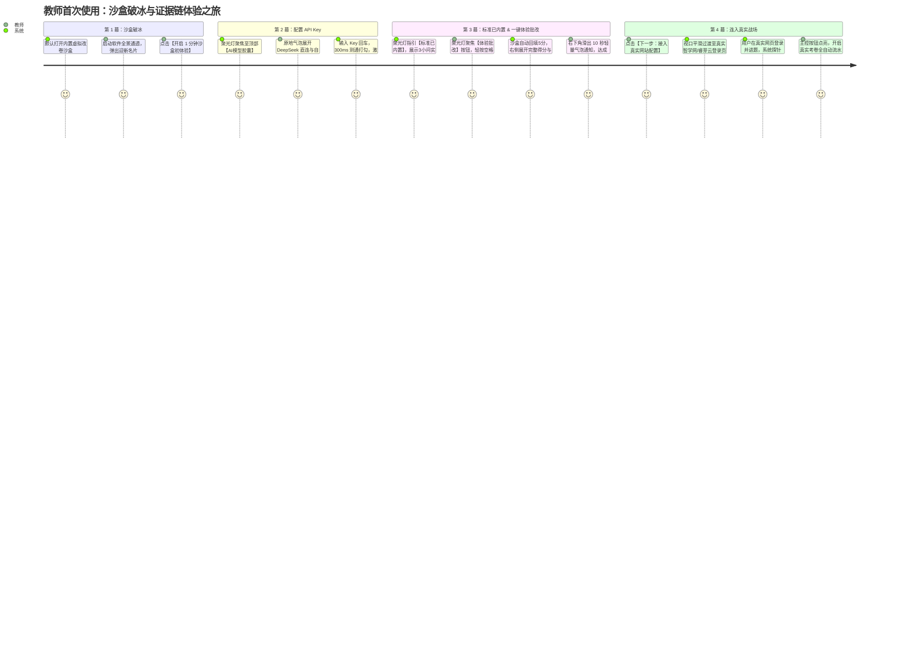

# 范式 2：原地聚光灯与真实验卷现场教学（In-Situ Spotlight Tour）完整实施方案

> **设计基石**：彻底摒弃在局促侧边栏“填表答题”的低效模式。将引导融入**真实的业务发生现场**，通过优雅的沉浸式暗场、平滑飞行的光圈、吸附在真实控件旁的原地微气泡，带教师像玩通关游戏一样，1 分钟内完成配置并上手改卷。

---

## 一、 整体交互体验流程（沙盒破冰 ➔ 证据链展开 ➔ 真实平台接入）



---

## 二、 核心技术实现步骤（工业级前端架构）

### 步骤 1：构建高性能“无感镂空聚光灯遮罩”（Spotlight Mask Engine）

聚光灯的本质是全屏半透明暗场（如 `rgba(23, 33, 38, 0.72)`），但能在目标真实 DOM 元素所在位置**无缝“挖出一个带圆角与呼吸发光的透明洞”**。

#### 1.1 核心算法实现：SVG Mask 动态穿透方案
在页面根层挂载一个全局 `SpotlightOverlay`，使用全屏 SVG 与 `mask` 元素：

```html
<svg class="spotlight-overlay" width="100%" height="100%">
  <defs>
    <mask id="spotlight-mask">
      <!-- 白底：全部遮挡（显示暗色遮罩） -->
      <rect width="100%" height="100%" fill="white" />
      <!-- 黑色挖孔矩形：完全透明露出目标元素，带 12px 圆角与平滑过渡 -->
      <rect 
        x="${rect.x - padding}" 
        y="${rect.y - padding}" 
        width="${rect.width + padding * 2}" 
        height="${rect.height + padding * 2}" 
        rx="10" 
        fill="black" 
        class="spotlight-hole-transition"
      />
    </mask>
  </defs>
  <!-- 最终遮罩矩形，应用上述 mask，并允许内部元素交互 -->
  <rect width="100%" height="100%" fill="rgba(23, 33, 38, 0.68)" mask="url(#spotlight-mask)" />
</svg>
```

#### 1.2 平滑飞行过渡与外发光光晕
- 目标切换时，SVG 中的 `rect` 的 `x, y, width, height` 通过 CSS `transition: all 0.35s cubic-bezier(0.16, 1, 0.3, 1)` 进行平滑变形飞行；
- 在被挖空的边缘叠加一层呼吸微光边框（`box-shadow: 0 0 0 4px rgba(14, 159, 152, 0.4), 0 0 24px rgba(14, 159, 152, 0.3)`），让教师视线立刻被牢牢锁死在发光区域。

---

### 步骤 2：精准锚定浮动气泡引擎（Anchor-Attached Tooltip Positioning）

气泡不能乱飞，它必须像磁铁一样**紧紧吸附在聚光灯高亮元素的最佳方位**（上方、下方、左侧或右侧），并带有小三角指针。

#### 2.1 动态视口防溢出定位计算
```ts
function computeAnchorPosition(targetRect: DOMRect, tooltipWidth = 360, tooltipHeight = 220) {
  const margin = 14;
  const viewportWidth = window.innerWidth;
  const viewportHeight = window.innerHeight;

  // 默认尝试吸附在目标下方
  let top = targetRect.bottom + margin;
  let left = targetRect.left + (targetRect.width - tooltipWidth) / 2;
  let placement = "bottom";

  // 若下方超出屏幕底部，自动翻转至上方
  if (top + tooltipHeight > viewportHeight - 20) {
    top = targetRect.top - tooltipHeight - margin;
    placement = "top";
  }

  // 左右边界夹逼保护
  left = Math.max(16, Math.min(left, viewportWidth - tooltipWidth - 16));

  return { top, left, placement };
}
```

---

### 步骤 3：设计四幕连续剧情境（沙盒先行 ➔ 证据链 ➔ 真实接入）

通过轻量级状态机 `currentStep: 0 | 1 | 2 | 3 | 4` 严格驱动导览，遵循**“沙盒破冰 ➔ 配置模型 ➔ 标准内置 ➔ 体验证据链 ➔ 真实平台接入”**的极致心流：

```
+---------------------------------------------------------------------------------------------------------+
| [第 0 关: 破冰] 居中欢迎卡片 ➔ 提示“先在免登录沙盒体验批改，亲眼见证证据链，再接入真实智学网”            |
|                                                                                                         |
| [第 1 关: 唤醒AI大脑 — 配置模型 API Key] 聚光灯平移至顶部 [🧠 AI模型胶囊]                                  |
|   • 气泡提供直观双选胶囊：[ ⚡ DeepSeek (推荐直连) ]  vs  [ ⚙️ 自定义 API 服务 (SiliconFlow/智联等) ]       |
|     1. DeepSeek 直连：系统预置官方地址防错，只需填写 API_KEY 与模型名，开箱即用；                       |
|     2. 自定义 API 服务：支持填写私有 Base URL (通常需 /v1)、Key 与 Model；                              |
|   • 点击【测通连通性 (Enter)】 ➔ 300ms 测通通过 ➔ 顶部胶囊变绿打勾已激活，点亮下一步按钮！               |
|                                                                                                         |
| [第 2 关: 评分标准已官方预置就绪] 聚光灯平移至顶部 [📋 评分标准选择器]                                    |
|   • 免去初次使用的繁琐录入！系统已为您预装了官方标准《第13题 验证牛顿第二定律》完整细则 (6.0分)；         |
|   • 包含 3 小问细则卡片与第(2)问【严查2位有效数字】扣分警告；                                           |
|   • 右侧核对伴侣视口已同步展开细则卡片，无需编辑，直接点击下一步进入体验批改！                           |
|                                                                                                         |
| [第 3 关: 一键体验沙盒批改 ➔ 完整证据链与手写切片展现] 聚光灯聚焦 [开始体验批改 (Space)]                 |
|   • 教师轻按空格键或点击按钮 ➔ AI 500ms 内完成极速批改；                                                |
|   • 沙盒总分回填 5.0 分，原图上的手写切片框依次展开高亮；                                                |
|   • 右侧伴侣视口自动切到【批改结果】模式并高亮：                                                         |
|     - 总分 5.0 / 6.0 分；                                                                               |
|     - 小问(1): 2.0 分 [满分] (切片: 间距相等)；                                                          |
|     - 小问(2): 1.0 分 [扣1分: 未保留2位有效数字] (切片: a = 1.4 m/s²)；                                 |
|     - 小问(3): 2.0 分 [满分] (切片: 过原点倾斜直线)；                                                   |
|   • 右下角滑出 10 秒轻量倒计时通知气泡，教师亲眼见证透明且无可挑剔的扣分依据 (Aha! Moment)；            |
|   • 气泡提示完成并点亮：【下一步: 接入真实网站配置 ›】                                                  |
|                                                                                                         |
| [第 4 关: 接入真实网站配置 (智学网 / 睿芽云)] 聚光灯聚焦中央 [内嵌浏览器视口]                             |
|   • 浏览器视口平滑淡出沙盒，切入真实智学网登录与评卷界面，激光扫描雷达启动；                             |
|   • 教师自主在智学网输入账号密码/扫码登录，点击进入要评阅的物理试卷与具体题号；                           |
|   • 适配器实时后台探测：学生答卷原图可提取 ✓、智学网总分打分框可写入 ✓、翻页/提交控件可访问 ✓             |
|   • 探测成功后，主控按钮点亮，开启真实考卷全自动流水线！                                                 |
+---------------------------------------------------------------------------------------------------------+
```

---

### 步骤 4：主进程内嵌浏览器（BrowserView）与聚光灯的协同机制

在 Electron 中，目标阅卷网页是一个原生的 `BrowserView`，普通 HTML 遮罩层默认可能被 BrowserView 遮挡或产生渲染层级冲突。

#### 4.1 完美的层级与穿透方案：
1. **统一视口坐标感知**：主渲染进程维护智学网容器 div 的精确 `getBoundingClientRect()`，当聚光灯照射到智学网时，遮罩挖空区域精准对齐该矩形；
2. **交互事件直通**：
   - 在第 1 步（聚焦在智学网视口时）：遮罩在智学网区域设置 `pointer-events: none`，此时用户在智学网区域内的每一次点击、打字登录、选试卷完全不受遮挡、原生流畅！
   - 在第 2、3、4 步（聚焦在主界面顶部控制栏时）：遮罩层拦截全局鼠标，防止用户误触网页其他无关链接；
3. **网页状态反向广播与硬门禁解开**：
   - 智学网适配器（`zhixueAdapter.ts`）在检测到底层 iframe 答卷、分数输入框与提交按钮全部就绪时，向前端发出 `controls_ready` 事件；
   - 聚光灯引擎捕获到事件后，解除第 1 关的硬门禁，右下角【下一步】按钮从灰色 `🔒` 变为高亮翡翠绿并带有柔和微跳动，教师从容点击即可推进！

---

### 步骤 5：断点续传与“免打扰”防御机制

1. **首次安装自动触发**：
   - `localStorage.getItem("hengzhun.tourCompleted.v1")` 为空时，新用户首次打开工作台自动以优雅的入场动画激活；
2. **随时随地可退出**：
   - 气泡右上角始终常驻一个精致的 `[跳过导览 (Esc)]` 按钮，教师随时可以退出，绝不绑架用户；
3. **设置页一键重放**：
   - 顶部工具栏或应用设置中提供一个带有小星星的胶囊按钮：`✨ 重新体验 1 分钟现场导览`，供新任课教师随时温习。

---

## 三、 为什么这是碾压“侧栏点点点”的终极方案？

| 评价维度 | 传统侧边栏填表 | **原地聚光灯现场导览 (In-Situ Tour)** |
|---|---|---|
| **认知负荷** | **极高**（视线在左边窄栏和右边大屏反复横跳，不知道彼此关系） | **极低**（光圈打在哪，眼睛就看哪；气泡就贴在目标旁边） |
| **空间利用** | **极差**（侧边栏硬生生吃掉 400px 宽度，导致 1080p 笔记本网页挤扁） | **完美**（平时 100% 留给智学网，导览浮层悬浮且自适应） |
| **交互乐趣** | **枯燥如填报税单**（一堆输入框、单选按钮和下一步） | **如游戏通关般流畅**（打勾、光圈飞行动效、检测成功扩散绿光） |
| **现场感** | **完全脱节**（在侧栏里选“智学网适配器”，根本不知道网页在哪） | **真实验卷现场**（直接在智学网页面上登录、点题，系统自动识别感应） |
