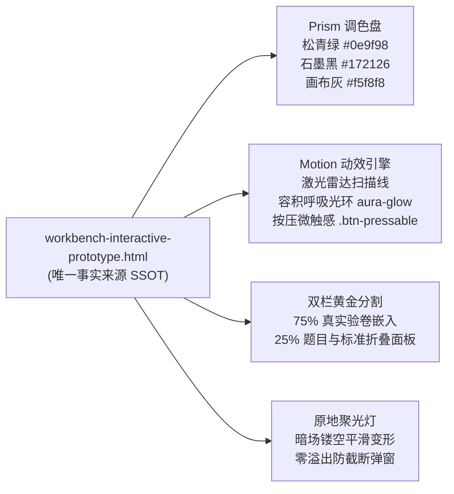

# 《衡准 · 物理阅卷工作台》界面重构设计方案与美学标准白皮书
> **面向对象**：产品经理、UI/UX 设计师、ChatGPT / Claude 等大模型 Prompt 指令、Codex 自动化代码智能体、前端开发团队  
> **文档版本**：v2.3 · 2026 旗舰增强版（**严格对齐 Demo 权威基线版**）  
> **核心原则**：以 [`docs/workbench-redesign/workbench-interactive-prototype.html`](./workbench-interactive-prototype.html) 为**全系统唯一的视觉风格与交互动效事实来源（Single Source of Truth, SSOT）**，所有视觉与组件设计必须严格忠实于该 Demo。

---

## 目录
- [一、 核心设计目标与产品愿景 (Design Goals)](#一-核心设计目标与产品愿景-design-goals)
- [二、 权威对标对象：Demo (workbench-interactive-prototype.html) 精髓](#二-权威对标对象demo-workbench-interactive-prototypehtml-精髓)
- [三、 视觉美学标准：Prism Precision 棱镜设计系统](#三-视觉美学标准prism-precision-棱镜设计系统)
  - [3.1 核心设计变量与色彩系统（完全提取自 Demo）](#31-核心设计变量与色彩系统完全提取自-demo)
  - [3.2 字体排版与数学公式渲染阶梯](#32-字体排版与数学公式渲染阶梯)
  - [3.3 微质感边框、卡片与高级阴影](#33-微质感边框卡片与高级阴影)
  - [3.4 工业级动效库（激光扫描、呼吸光环与物理按压）](#34-工业级动效库激光扫描呼吸光环与物理按压)
- [四、 核心模块布局与架构（完全映射 Demo 结构）](#四-核心模块布局与架构完全映射-demo-结构)
  - [4.1 顶部驾驶舱态势栏 (h-16, Header)](#41-顶部驾驶舱态势栏-h-16-header)
  - [4.2 工作台双栏视口 (75% 真实验卷 + 25% 题目与标准折叠面板)](#42-工作台双栏视口-75-真实验卷--25-题目与标准折叠面板)
  - [4.3 微缩高保真侧边栏 (w-48, Aside)](#43-微缩高保真侧边栏-w-48-aside)
- [五、 空间边界防御与防 UI 排布溢出硬性铁律 (Anti-Overflow & Boundary Defense)](#五-空间边界防御与防-ui-排布溢出硬性铁律-anti-overflow--boundary-defense)
  - [5.1 根容器与横向滚动条绝对防御](#51-根容器与横向滚动条绝对防御)
  - [5.2 Windows 系统 DPI 缩放灾难防御 (100% / 125% / 150%)](#52-windows-系统-dpi-缩放灾难防御-100--125--150)
  - [5.3 复杂 KaTeX 长公式与手写转录截断熔断机制](#53-复杂-katex-长公式与手写转录截断熔断机制)
  - [5.4 手写高清切图极端长宽比容器自适应](#54-手写高清切图极端长宽比容器自适应)
  - [5.5 Z-Index 严格分层架构与视口穿透防御](#55-z-index-严格分层架构与视口穿透防御)
  - [5.6 Electron 原生 BrowserView 与 DOM 像素级尺寸同步](#56-electron-原生-browserview-与-dom-像素级尺寸同步)
  - [5.7 聚焦引导（Spotlight Tour）对话框定位引擎与零溢出防御架构](#57-聚焦引导spotlight-tour对话框定位引擎与零溢出防御架构)
- [六、 真实界面用户 E2E 体验验证与验收标准 (Real-World E2E Verification)](#六-真实界面用户-e2e-体验验证与验收标准-real-world-e2e-verification)
- [七、 启动 Codex 落地重构的官方指令 Prompt (Codex Launch Prompt)](#七-启动-codex-落地重构的官方指令-prompt-codex-launch-prompt)
- [八、 供 ChatGPT / Claude 进行 UI 设计对话的 Prompt (UI Chat Prompt)](#八-供-chatgpt--claude-进行-ui-设计对话的-prompt-ui-chat-prompt)

---

## 一、 核心设计目标与产品愿景 (Design Goals)

### 1.1 核心痛点与场景认知
高中物理阅卷老师通常需要在电脑屏幕前连续工作 **8 ~ 12 小时**，面对成百上千份字迹潦草、包含复杂物理受力图与公式推导的试卷。
- **痛点 1（空间挤压）**：传统客户端常将大块屏幕分配给静态菜单、控制卡片和庞大侧边栏，导致核心的“学生手写答卷视口”严重受限，教师需要不断手动缩放和平移。
- **痛点 2（视觉疲劳）**：大面积高饱和白色刺眼背景、杂乱无序的色块、突兀的红叉导致眼睛干涩、认知负荷极大。
- **痛点 3（信任缺失）**：AI 判定分数时如果只展示一个“总分”或一段模糊文字，教师不敢放行；必须让“卷面手写切片、扣分点、逻辑争议”与打分**并列即时呈现**。

### 1.2 三大核心设计目标
1. **答卷视口极限化（Content-First）**：真实验卷网页或原图占据 **70%~75%** 以上的核心屏幕区域，让教师看清每一笔手写受力分析与下标。
2. **态势感知与一键启停（Cockpit HUD）**：顶部驾驶舱（高度 64px）整合核心状态：评分标准选择器、AI 模型连接胶囊、主控启停键（Space 快捷键）、统计计数器。
3. **伴侣式证据链与切片核对（Evidence Companion）**：右侧提供可随时收折的核对面，精准展示：**手写局部高清切图**、**教师模型扣分裁决**、**置信度指示灯**与**原始转录对照**。

---

## 二、 权威对标对象：Demo (workbench-interactive-prototype.html) 精髓

所有的设计与代码落地，**必须严格对照 Demo 原型 [`workbench-interactive-prototype.html`](./workbench-interactive-prototype.html)**：



---

## 三、 视觉美学标准：Prism Precision 棱镜设计系统

> [!IMPORTANT]
> **审美红线**：严禁随意更改 Demo 中已定义的颜色 HEX 值、阴影参数与缓动曲线。所有样式必须 100% 遵照 Demo 的 CSS 变量体系。

### 3.1 核心设计变量与色彩系统（完全提取自 Demo）

Demo 中定义的根变量如下，全局必须直接复用：

```css
:root {
  /* 品牌主色调：衡准松青绿 (Teal / Jade) */
  --prism-brand: #0e9f98;
  --prism-brand-hover: #0d8c88;
  --prism-brand-soft: #e8f8f6;

  /* 文字与层级色 */
  --prism-graphite: #172126; /* 主标题与正文 */
  --prism-muted: #66717d;    /* 次级文字、说明 */
  --prism-subtle: #929ca6;   /* 占位符、小标 */

  /* 背景与表面色 */
  --prism-canvas: #f5f8f8;   /* 页面主背景画布 */
  --prism-paper: #ffffff;    /* 视口/卡片表面纸张色 */

  /* 分割线与边框 */
  --prism-line: #e2e8ec;        /* 常规细腻分割线 (1px) */
  --prism-line-strong: #cfd9de; /* 强化边框、容器外框 (1px) */

  /* 功能语义色 */
  --prism-success: #2e9b65; /* 满分/已连接绿 */
  --prism-amber: #c98718;   /* 待配置/待复核琥珀黄 */
  --prism-blue: #3478f6;    /* 题目/信息蓝 */
  --prism-rose: #c94b50;    /* 扣分/未保留有效数字红 */

  /* 工业级高阶缓动曲线定义 */
  --ease-spring: cubic-bezier(0.16, 1, 0.3, 1);
  --ease-bounce: cubic-bezier(0.34, 1.45, 0.64, 1);
  --ease-smooth: cubic-bezier(0.4, 0, 0.2, 1);
}
```

---

### 3.2 字体排版与数学公式渲染阶梯

- **主体字体栈**：`-apple-system`, `BlinkMacSystemFont`, `"Segoe UI Variable"`, `"Segoe UI"`, `"Noto Sans SC"`, `"Microsoft YaHei UI"`, `sans-serif`
- **等宽与数值栈（Tabular Nums）**：`"Cascadia Code"`, `"Cascadia Mono"`, `Consolas`, `monospace`（用于题号、分值、SHA 哈希值、批改耗时）
- **公式符号**：原生嵌入 **KaTeX**，保证分式与物理符号印刷级清晰。

---

### 3.3 微质感边框、卡片与高级阴影

- **1px 细线边框**：全站卡片统一采用 `1px solid var(--prism-line)` 或 `1px solid var(--prism-line-strong)`，彻底剔除 2px 粗黑边。
- **微微阴影体系**：
  - `shadow-2xs`: `0 1px 2px rgba(0, 0, 0, 0.04)`
  - `shadow-xs`: `0 1px 3px rgba(0, 0, 0, 0.08)`
  - `shadow-sm`: `0 2px 8px -2px rgba(23, 33, 38, 0.08)`
- **圆角体系**：卡片与视口 `rounded-xl` (12px)，内嵌切片 `rounded-lg` (8px)，微标 `rounded` (4px)。

---

### 3.4 工业级动效库（激光扫描、呼吸光环与物理按压）

必须完全复刻 Demo 的三大标志性动效：

#### 1. 激光雷达扫描线 (Laser Scanline)
在批改中时，真实验卷上方滑过翡翠渐变激光线：
```css
@keyframes laser-scan {
  0% { top: 0%; opacity: 0; }
  15% { opacity: 1; }
  85% { opacity: 1; }
  100% { top: 100%; opacity: 0; }
}
.laser-scanner {
  position: absolute;
  left: 0;
  right: 0;
  height: 3px;
  background: linear-gradient(90deg, transparent, #0e9f98, #2e9b65, transparent);
  box-shadow: 0 0 16px 4px rgba(14, 159, 152, 0.6);
  animation: laser-scan 2.2s infinite ease-in-out;
  pointer-events: none;
  z-index: 25;
}
```

#### 2. 聚光灯动态呼吸容积光环 (Aura Glow)
聚光灯边缘具有生命感的光晕跳动：
```css
#spotlight-aura {
  transition: all 0.5s var(--ease-spring);
  box-shadow: 0 0 0 3px rgba(14, 159, 152, 0.7), 0 0 45px rgba(14, 159, 152, 0.45);
  animation: aura-glow 2.4s infinite alternate ease-in-out;
}
@keyframes aura-glow {
  0% { box-shadow: 0 0 0 3px rgba(14, 159, 152, 0.5), 0 0 25px rgba(14, 159, 152, 0.35); }
  100% { box-shadow: 0 0 0 5px rgba(14, 159, 152, 0.85), 0 0 55px rgba(14, 159, 152, 0.55); }
}
```

#### 3. 按钮物理按压动效 (.btn-pressable)
所有可点击按钮与卡片必须挂载微触感按压：
```css
.btn-pressable {
  transition: transform 0.15s cubic-bezier(0.4, 0, 0.2, 1), box-shadow 0.15s ease, background-color 0.15s ease;
}
.btn-pressable:hover {
  transform: translateY(-1px);
}
.btn-pressable:active {
  transform: translateY(1.5px) scale(0.97);
}
```

---

## 四、 核心模块布局与架构（完全映射 Demo 结构）

### 4.1 顶部驾驶舱态势栏 (h-16, Header)
- **左侧：评分标准选择卡片 (`#anchor-rubric-selector`)**：
  - 点击直达侧边栏标准管理；
  - 带有微绿背景图标、题号标题、满分微标与已锁定安全描述。
- **中间：AI 状态胶囊 + 主控大按钮**：
  - **AI 胶囊 (`#anchor-model-capsule`)**：bg-[#fff6e7], border-[#c98718]/40, 琥珀色脉冲呼吸灯，点击可原地弹出 API Key 快速配置气泡；
  - **主控按钮 (`#anchor-main-btn`)**：h-10 px-6, bg-[#0e9f98], 播放三角图标，醒目提示 `(Space)`。
- **右侧：题目标准折叠开关 + 实时计数器**：
  - 折叠开关 (`#btn-toggle-inspector`)，快捷键 `R`；
  - 已批改数量（大号 Cascadia Mono）与均分指示器。

### 4.2 工作台双栏视口 (75% 真实验卷 + 25% 题目与标准折叠面板)
- **左/中：真实验卷浏览器视口 (`#anchor-browser-viewport`)**：
  - 顶部渐变标题栏（深青至深蓝），标识 SANDBOX 沙盒或真实智学网模式；
  - 答卷原图卡片（带 SHA 哈希徽标）；
  - 手写作答区与 AI 扫描切片高亮框依次展开动效 (`#ai-scan-markers`)。
- **右侧：题目原文与评分标准抽屉 (`#panel-rubric-inspector`)**：
  - 支持快捷键一键折叠/展开；
  - 展示题目文本、各小问分值、KaTeX 标答方程组与过程给分细则。

### 4.3 微缩高保真侧边栏 (w-48, Aside)
- 仅保留：品牌 Logo、工作台导航、评分标准导航、历史记录以及底部“自动化守护已就绪”绿灯。

---

## 五、 空间边界防御与防 UI 排布溢出硬性铁律 (Anti-Overflow & Boundary Defense)

> [!CAUTION]
> 界面必须能在教师的真实 1080p 笔记本电脑（尤其是 Windows 125% 或 150% 缩放，实际有效高度仅 720px）上稳定运行。

### 5.1 根容器与横向滚动条绝对防御
1. 应用根容器 `#root` 强制 `overflow-x: hidden; width: 100vw; max-width: 100vw;`。除特定公式容器外，**严禁页面出现全局横向滚动条**。
2. 所有水平 Flex 容器的文字子项**必须声明 `min-width: 0`**，图标必须声明 `flex-shrink: 0`。

### 5.2 Windows 系统 DPI 缩放灾难防御 (100% / 125% / 150%)
1. 按钮文字强制 `white-space: nowrap; text-overflow: ellipsis;`，杜绝文字折行或把相邻元素顶飞。
2. 屏幕可用宽度 $< 1280px$ 时，右侧抽屉自动压缩或转为折叠浮层。

### 5.3 复杂 KaTeX 长公式与手写转录截断熔断机制
所有 KaTeX 节点必须包裹在 `.katex-safe-container`（`max-width: 100%; overflow-x: auto;`）内，自带极细滚动条，绝对杜绝长公式撑爆卡片。

### 5.4 手写高清切图极端长宽比容器自适应
切图卡片约束 `max-height: 220px; object-fit: contain; background: #0D0F14;`，杜绝变形拉伸。

### 5.5 Z-Index 严格分层架构与视口穿透防御
全系统分层：
`Layer 0 (底层验卷视口)` $\rightarrow$ `Layer 10 (右侧抽屉)` $\rightarrow$ `Layer 20 (顶栏态势栏)` $\rightarrow$ `Layer 50 (下拉气泡)` $\rightarrow$ `Layer 100 (聚光灯暗场)` $\rightarrow$ `Layer 110 (高亮聚焦目标与指引弹窗)` $\rightarrow$ `Layer 200 (灯箱)` $\rightarrow$ `Layer 999 (Toast)`。

### 5.6 Electron 原生 BrowserView 与 DOM 像素级尺寸同步
主视口通过 `ResizeObserver` + `requestAnimationFrame` 驱动原生 `updateViewBounds`，保证原生网页与边框之间 0 像素缝隙。

### 5.7 聚焦引导（Spotlight Tour）对话框定位引擎与零溢出防御架构
- **基于视口碰撞的主动翻转（Auto-Flip）**：高亮上半屏目标时默认向下弹出，一旦底部距离不足自动翻转至目标上方；靠右目标向左弹出。
- **16px 视口钳位（Clamping）**：卡片水平位置强制执行 `clamp(16px, targetCenter - width/2, window.innerWidth - width - 16px)`。
- **滑轨动态自适应箭头（Sliding Arrow）**：箭头根据目标实际中心动态滑动，确保即使弹窗避让边缘，箭头也永远死死咬住目标控件中心！
- **三层固定盒模型（Pinned Footer）**：气泡卡片 Header 与 Footer 必须 `flex-shrink: 0;`（操作按钮永远在可视范围内），Body 内部超出纵向滚动。
- **Direct Body Portal**：引导弹窗必须通过 `createPortal(..., document.body)` 挂载，彻底摆脱父级 `overflow: hidden` 裁切。

---

## 六、 真实界面用户 E2E 体验验证与验收标准 (Real-World E2E Verification)

1. **五组分辨率实机测试矩阵**：`1920×1080 @ 100%`、`1920×1080 @ 125%`、`1920×1080 @ 150%`、`2K @ 125%`、`1366×768 @ 100%`。
2. **破坏性压力测试**：600 字超长评语、8 个小问长卷轴、换卷 3 秒网络延迟骨架屏。
3. **“五禁五必”一票否决红线**：禁全局横向滚动条、禁公式撑破容器、禁文字折叠重叠、禁遮挡打分输入框、禁卡死无反馈；必保持视口 $\ge 70\%$、必适配 125%/150% 缩放、必独立纵向滚动、必保持手写高对比度、必支持单空格键无缝起停。

---

## 七、 启动 Codex 落地重构的官方指令 Prompt (Codex Launch Prompt)

> [!TIP]
> **使用方法**：直接复制下方指令并发送给 Codex，开始依据 Demo 进行代码落地。

````markdown
# Codex Mission: 衡准·物理改卷工作台 严格对照 Demo 重构与工程落地

## 1. 任务背景与核心使命
你正在为《衡准 · 物理阅卷工作台》（Electron + React 19 + TypeScript 严格模式）执行工作台界面重构。
你必须将项目中的 `docs/workbench-redesign/workbench-interactive-prototype.html` 作为**唯一的视觉样式、组件排布与交互动效事实来源 (Source of Truth)**，严格对照该 Demo 进行 1:1 高保真代码落地！

## 2. 必须阅读的参考与规则文件
在修改代码前，你必须完整阅读并遵守以下文件：
- `AGENTS.md`：核心设计不变量（计分权威、复核安全、防串卷三道防线、严格 json_schema、标准验证链）。
- `docs/workbench-redesign/workbench-interactive-prototype.html`：【绝对视觉真理之源】包含完整的配色、DOM 结构、激光扫描线、聚光灯光晕与按压微触感。
- `docs/workbench-redesign/workbench-design-spec-and-aesthetic-standards.md`：设计白皮书（Prism 设计变量、防溢出铁律、E2E 验收清单）。
- `docs/workbench-redesign/spotlight-tour-implementation.md`：现场暗场聚光灯与沙盒破冰实施细则。

## 3. 严格对照 Demo 的视觉美学与动效约束
1. **完全复刻 Demo 的颜色与变量**：
   - 主色调必须使用 `--prism-brand: #0e9f98`，悬停 `--prism-brand-hover: #0d8c88`，浅底 `--prism-brand-soft: #e8f8f6`；
   - 文本采用石墨黑 `--prism-graphite: #172126`，画布背景 `--prism-canvas: #f5f8f8`，纸张纯白 `--prism-paper: #ffffff`；
   - 边框采用细微分割线 `--prism-line: #e2e8ec` 与加强线 `--prism-line-strong: #cfd9de`；
   - 严禁自行发明或改换暗色怪异配色，一切以 Demo 的清新精密医用/工业级质感为准！
2. **完整复刻 Demo 的交互动效**：
   - 按钮与卡片必须挂载 `.btn-pressable` 物理微触感（hover 上浮 1px，active 下沉 1.5px 缩放 0.97）；
   - 批改中必须呈现 Demo 中的激光雷达扫描线 `.laser-scanner`（带有翡翠绿色扩散发光与匀速扫描）；
   - 聚光灯聚焦必须具备 `#spotlight-aura` 呼吸光晕（0~55px 扩散）与平滑变形阻尼。
3. **完全复刻 Demo 的界面排布**：
   - 顶部驾驶舱（h-16）：评分标准选择卡片（左）、AI 模型指示胶囊与开始批改主控按钮（中）、标准折叠开关与批改计数器（右）；
   - 主内容区双栏网格：左侧 75% 智学网/沙盒验卷嵌入容器，右侧 25% 题目原文与评分标准抽屉（支持 R 键折叠展开）；
   - 侧边栏（w-48）：微缩高保真导航栏。
4. **空间边界与聚焦弹窗防溢出铁律**：
   - 根容器强制 `overflow-x: hidden;`，严禁横向滚动条；
   - 水平 Flex 文本必须设置 `min-width: 0;`，图标设置 `flex-shrink: 0;`；
   - 聚焦引导气泡必须实现 Auto-Flip 智能视口翻转、16px 屏幕钳位、滑轨自适应三角箭头，且通过 `createPortal` 挂载至 `document.body`；
   - 气泡卡片 Header 与 Footer 必须 `flex-shrink: 0;`，底部操作按钮永远锁定在可视区域内。

## 4. 标准实施步骤 (Phased Plan)
- **Phase 1: 提取 Demo 样式与防溢出基础**
  - 在 `src/desktop.css` 中完整注入 Demo 的 `:root` 变量、`.btn-pressable`、`.laser-scanner`、`#spotlight-aura` 样式。
  - 创建 `src/useSmartPositioning.ts` 实现视口碰撞检测与滑轨箭头计算。
- **Phase 2: 零溢出聚焦引导与沙盒破冰组件**
  - 根据 Demo 实现 `SpotlightTour` 模块，包含沙盒样本跑通、API Key 配置弹窗与真实考卷感应。
- **Phase 3: 工作台主界面对照 Demo 重构**
  - 依照 Demo 的 DOM 结构重构 `src/DesktopApp.tsx` 的工作台驾驶舱与双栏网格，保持 Electron 原生 BrowserView 边界同步。
- **Phase 4: 全量回归与标准验证链**
  - 执行：`npx tsc -b` -> `npx tsc -p tsconfig.server.json` -> `npx tsc -p tsconfig.electron.json` -> `npx vitest run` -> `npm run build`。
  - 确保 50 个测试文件、454 项测试全绿，0 编译错误。

请一步一步稳妥推进，每完成一个阶段均验证类型与功能完整性。
````

---

## 八、 供 ChatGPT / Claude 进行 UI 设计对话的 Prompt (UI Chat Prompt)

如果你是在 ChatGPT 或 Claude 对话框中进行 UI 组件微调或探讨，请复制以下 Prompt：

````markdown
你是一位精通微质感与精密物理仪器风格的前端架构师。
请严格对照 `docs/workbench-redesign/workbench-interactive-prototype.html` 的视觉设计系统（Prism Precision Design System）协助我开发组件：
1. 品牌主色为衡准松青绿 #0e9f98，辅以石墨黑 #172126 与纯净画布灰 #f5f8f8，边框采用 1px 细线 #e2e8ec。
2. 动效复刻 Demo 中的 .btn-pressable 物理微触感与 .laser-scanner 激光雷达扫描动效。
3. 严格防溢出：根容器无横向滚动，聚焦弹窗支持视口碰撞 Auto-Flip 自动翻转、16px 视口钳位与滑轨自适应箭头。
请产出符合 React 19 + TypeScript 严格标准的纯净代码。
````

---
> *本设计规范书由衡准团队深度研发制定，作为全自动物理阅卷系统的视觉与交互终极基线。*
