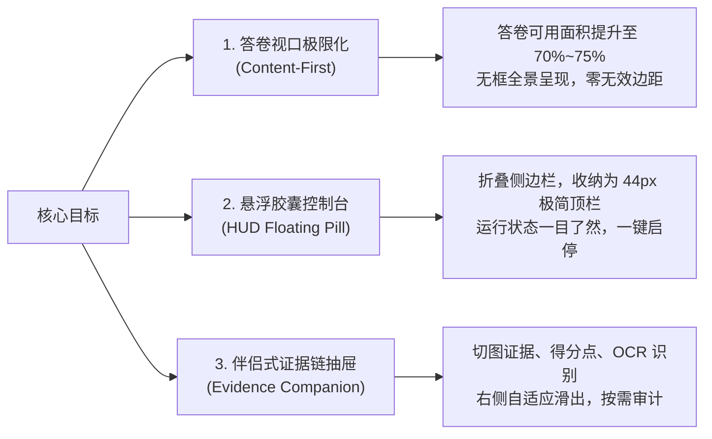
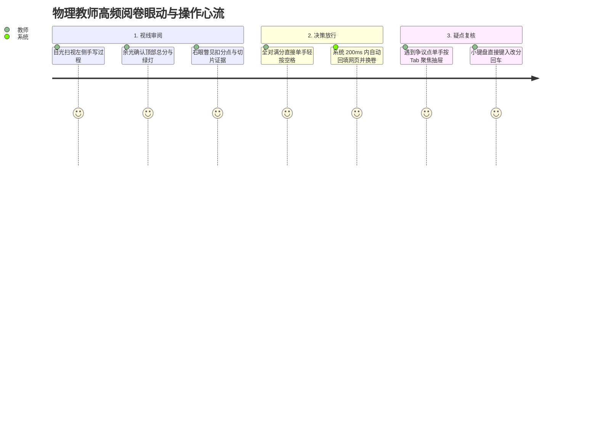

# 《衡准 · 物理阅卷工作台》界面重构设计方案与美学标准白皮书
> **面向对象**：产品经理、UI/UX 设计师、ChatGPT / Claude 等大模型 Prompt 指令、前端开发团队  
> **文档版本**：v2.1 · 2026 旗舰增强版（含防溢出硬防御与用户 E2E 验收全清单）  
> **核心使命**：将传统“局促、挤压、填表式”的本地桌面改卷软件，蜕变为**极客级、高沉浸、暗场抗疲劳、毫秒级证据链回放的下一代 AI 阅卷工作台**。

---

## 目录
- [一、 核心设计目标与产品愿景 (Design Goals)](#一-核心设计目标与产品愿景-design-goals)
- [二、 应当参考的顶级对象与设计精髓 (Benchmark References)](#二-应当参考的顶级对象与设计精髓-benchmark-references)
- [三、 视觉美学标准与设计系统规范 (Aesthetic Standards)](#三-视觉美学标准与设计系统规范-aesthetic-standards)
  - [3.1 色彩哲学与暗场抗疲劳系统](#31-色彩哲学与暗场抗疲劳系统)
  - [3.2 字体排版与数学公式渲染阶梯](#32-字体排版与数学公式渲染阶梯)
  - [3.3 空间网格、微质感与毛玻璃层次](#33-空间网格微质感与毛玻璃层次)
  - [3.4 动效与交互微反馈规范](#34-动效与交互微反馈规范)
- [四、 核心模块重构方案设计细则 (Module Specifications)](#四-核心模块重构方案设计细则-module-specifications)
- [五、 空间边界防御与防 UI 排布溢出硬性铁律 (Anti-Overflow & Boundary Defense)](#五-空间边界防御与防-ui-排布溢出硬性铁律-anti-overflow--boundary-defense)
  - [5.1 根容器与横向滚动条绝对防御](#51-根容器与横向滚动条绝对防御)
  - [5.2 Windows 系统 DPI 缩放灾难防御 (100% / 125% / 150%)](#52-windows-系统-dpi-缩放灾难防御-100--125--150)
  - [5.3 复杂 KaTeX 长公式与手写转录截断熔断机制](#53-复杂-katex-长公式与手写转录截断熔断机制)
  - [5.4 手写高清切图极端长宽比（长条/窄高）容器自适应](#54-手写高清切图极端长宽比长条窄高容器自适应)
  - [5.5 Z-Index 严格分层架构与视口穿透防御](#55-z-index-严格分层架构与视口穿透防御)
  - [5.6 Electron 原生 BrowserView 与 DOM 像素级尺寸同步](#56-electron-原生-browserview-与-dom-像素级尺寸同步)
- [六、 真实界面用户 E2E 体验验证与验收标准 (Real-World E2E Verification)](#六-真实界面用户-e2e-体验验证与验收标准-real-world-e2e-verification)
  - [6.1 全分辨率与 Windows 缩放实机矩阵测试](#61-全分辨率与-windows-缩放实机矩阵测试)
  - [6.2 真实阅卷业务场景的压力极限用例](#62-真实阅卷业务场景的压力极限用例)
  - [6.3 物理教师眼动心流与操作人体工学核对](#63-物理教师眼动心流与操作人体工学核对)
  - [6.4 界面验收“五禁五必”一票否决红线](#64-界面验收五禁五必一票否决红线)
- [七、 可直接提供给 ChatGPT / AI 的设计指导指令 (Prompt Template)](#七-可直接提供给-chatgpt--ai-的设计指导指令-prompt-template)

---

## 一、 核心设计目标与产品愿景 (Design Goals)

### 1.1 核心痛点与场景认知
高中物理阅卷老师通常需要在电脑屏幕前连续工作 **8 ~ 12 小时**，面对成百上千份字迹潦草、包含复杂物理受力图与公式推导的试卷。
- **痛点 1（空间挤压）**：传统客户端常将大块屏幕分配给静态菜单、控制卡片和庞大侧边栏，导致核心的“学生手写答卷视口”严重受限，教师需要不断手动缩放和平移。
- **痛点 2（视觉疲劳）**：大面积高饱和白色刺眼背景、杂乱无序的色块、突兀的红叉导致眼睛干涩、认知负荷极大。
- **痛点 3（信任缺失）**：AI 判定分数时如果只展示一个“总分”或一段模糊文字，教师不敢放行；必须让“卷面手写切片、扣分点、逻辑争议”与打分**并列即时呈现**。

### 1.2 三大核心设计目标



1. **答卷视口极限化（Content-First & 0-Chrome）**：
   - 界面上所有装饰性边框、多余层级必须退让。真实验卷网页或原图占据 **70%~75%** 以上的核心屏幕区域，让教师看清每一笔手写受力分析与下标。
2. **悬浮式 HUD 胶囊交互（Floating HUD Capsule）**：
   - 将原先笨重杂乱的左侧大抽屉、上层设置栏，重构为类似 macOS 动态岛或 Raycast 的**顶部悬浮胶囊**（高度 ≤ 44px）。仅露出核心：当前批卷进度、当前分值、站点探针绿灯、主运行/暂停键。
3. **伴侣式证据链与小题切片抽屉（Evidence Companion）**：
   - 不再让复杂的评分明细遮挡答卷；右侧提供可随时收折的 280px~360px 证据伴侣抽屉，精准并列展示：**手写局部高清切图**、**教师模型扣分裁决**、**置信度指示灯**与**原始转录对照**。

---

## 二、 应当参考的顶级对象与设计精髓 (Benchmark References)

为打造真正世界级的产品体验，建议在 UI/UX 与工程落地时深度借鉴以下标杆产品：

| 标杆对象 | 对应产品形态 | 我们应当学习的核心精髓 |
| :--- | :--- | :--- |
| **Linear** | 极客级项目协作客户端 | • **极致的键盘优先理念**（Space 启停、J/K 切换、Esc 返回）<br>• **Subtle 1px 细线边框**（`rgba(255,255,255,0.08)`）取代重阴影<br>• **暗场 Obsidian 质感**：极具呼吸感的灰黑梯度与专业感<br>• **微交互响应**：输入焦点、状态切换均在 150ms 优雅回弹 |
| **Raycast / Arc Browser** | 浮动命令中心与沉浸式浏览器 | • **Floating Pill 胶囊布局**：将控制系统悬浮在视口之上，而非切分视口<br>• **状态感知呼吸灯**：使用微光脉冲（Pulse Glow）表达 AI 心跳与连通状态<br>• **渐进式展开（Progressive Disclosure）**：日常只有 5% 的视觉噪音，需要时一键展开全部细节 |
| **Figma / Adobe Lightroom** | 专业画布与检视器 | • **高清切片对比检视**：右侧检查器（Inspector）与左侧原画面的联动高亮<br>• **数值微调手感**：分数调整、复核覆盖（Override）具有即时反馈与撤销提示<br>• **视网膜级锐度**：暗色背景下学生手写笔迹反差自动增强 |
| **PACS 医疗影像工作站** | 放射科/病理学诊断系统 | • **证据链零丢失原则**：每一个判决必有对应的坐标切图与原始审计链<br>• **零歧义视觉警报**：用稳重耐看的 Amber（琥珀黄）表示疑似复核，避免大红大紫造成心理恐慌 |

---

## 三、 视觉美学标准与设计系统规范 (Aesthetic Standards)

### 3.1 色彩哲学与暗场抗疲劳系统

> [!IMPORTANT]
> 拒绝使用高纯度纯黑（`#000000`）或粗暴的纯白（`#FFFFFF`）。使用精密调配的**深曜石色（Obsidian Slate）**梯度，辅以精准的物理语义功能色。

#### 背景与表面色梯度（Surface Hierarchy）
* **Canvas 深空基底**：`#0B0D12`（最底层窗口底色，沉静、深邃）
* **Viewport 答卷容器**：`#12151D`（微抬升表面，与外部边框形成柔和层次）
* **Capsule 悬浮胶囊底色**：`rgba(22, 27, 38, 0.82)` 配合 `backdrop-filter: blur(16px)`
* **Card/Drawer 抽屉卡片**：`#181C26`（承载切片图与文字，高可读性）
* **Elevated Hover 悬浮态**：`#202634`（交互时的微高亮）

#### 语义功能色（Semantic Accents）
```
Emerald (全对/运行中)   : #10B981 | 边框: rgba(16, 185, 129, 0.3) | 背景: rgba(16, 185, 129, 0.1)
Amber (待复核/疑点)     : #F59E0B | 边框: rgba(245, 158, 11, 0.3) | 背景: rgba(245, 158, 11, 0.1)
Rose (扣分/异常终止)   : #F43F5E | 边框: rgba(244, 63, 94, 0.3)  | 背景: rgba(244, 63, 94, 0.1)
Indigo (AI推理/模型态)  : #6366F1 | 边框: rgba(99, 102, 241, 0.3) | 背景: rgba(99, 102, 241, 0.1)
Cyan (站点探针/连通)    : #06B6D4 | 边框: rgba(6, 182, 212, 0.3)  | 背景: rgba(6, 182, 212, 0.1)
```

---

### 3.2 字体排版与数学公式渲染阶梯

- **英文/数字主字体**：`Inter`, `-apple-system`, `BlinkMacSystemFont`, `sans-serif`
- **代码/数值显示（Tabular Nums）**：`JetBrains Mono`, `Consolas`, `monospace`（确保分值、耗时、坐标对齐不跳动）
- **中文字体栈**：`PingFang SC`, `Microsoft YaHei UI`, `Noto Sans SC`, `sans-serif`
- **公式符号**：原生嵌入 **KaTeX**，保证分式 $\frac{GMm}{r^2} = m\frac{v^2}{r}$ 与希腊字母 $\mu, \theta, \lambda$ 呈现印刷级清晰度。

#### 排版字阶（Type Scale）
1. **Hero HUD 分数**：`32px` / `line-height: 1` / `font-weight: 700`（如 `16 / 16`）
2. **一级标题/关键状态**：`15px` / `font-weight: 600` / `color: #F1F5F9`
3. **正文与手写转录**：`13px` / `line-height: 1.6` / `color: #CBD5E1`
4. **小题题号与元信息**：`12px` / `font-weight: 500` / `color: #94A3B8`
5. **审计微标（Badge）**：`11px` / `font-weight: 600` / `letter-spacing: 0.5px` / `text-transform: uppercase`

---

### 3.3 空间网格、微质感与毛玻璃层次

- **Hairline 细线边框原则**：全面剔除 2px 以上的厚笨边框，统一切换为 `1px solid rgba(255, 255, 255, 0.07)`。在卡片高光面可叠加 `border-top: 1px solid rgba(255, 255, 255, 0.12)` 产生精巧的倒角高光。
- **圆角体系（Radii）**：
  - 悬浮胶囊：`rounded-full` 或 `32px`
  - 核心视口与抽屉面板：`12px`
  - 内嵌切片图卡片与评分点：`8px`
  - 小型标签 Badge：`4px`
- **高阶内阴影（Inner Ambient Shadow）**：
  - 容器卡片使用内发光模拟物理金属/玻璃切面：`box-shadow: inset 0 1px 0 rgba(255, 255, 255, 0.08), 0 8px 24px rgba(0, 0, 0, 0.4)`。

---

### 3.4 动效与交互微反馈规范

1. **缓动曲线（Apple Smooth Easing）**：
   - 全局过渡使用：`transition: all 200ms cubic-bezier(0.16, 1, 0.3, 1)`。
2. **呼吸微光（Status Pulse）**：
   - 处于自动批改中时，运行指示点不仅变绿，还附带细腻的扩散呼吸环：
   ```css
   @keyframes pulse-ring {
     0% { transform: scale(0.95); opacity: 0.8; }
     50% { transform: scale(1.4); opacity: 0; }
     100% { transform: scale(0.95); opacity: 0; }
   }
   ```
3. **切片灯箱无缝平滑放大（Hero Layout Motion）**：
   - 点击小题局部切图时，通过平滑的局部展开飞入中央大图检视，保持视觉注意力不跳跃。

---

## 四、 核心模块重构方案设计细则 (Module Specifications)

### 4.1 总体视口网格切分（72% 验卷 + 28% 证据伴侣）

```
+-----------------------------------------------------------------------------------------+
| [● 衡准] [智学网: 已就绪 ●]  [批改中: 第 14/120 份]  [当前: 16分]  [ Space 暂停 ]  [设置/日志] | <-- 悬浮顶栏 (44px)
+-------------------------------------------------------------+---------------------------+
|                                                             | [证据伴侣抽屉: 展开 / 收起]  |
|                                                             |                           |
|                                                             | ● 第 (1) 问 [ 3 / 3 分 ]   |
|                 真实验卷 / 答题卡嵌入式视口                   |   [局部切片: R=12.0Ω]     |
|                                                             |   ✔ 最终答案正确 (快速通道)  |
|               (Webview / Electron BrowserView)              |---------------------------|
|                                                             | ▲ 第 (2) 问 [ 2 / 5 分 ]   |
|            保留 100% 原汁原味网页排版，无遮挡输入框            |   [局部切图: 步骤涂改处]    |
|                                                             |   -2 漏写方向判定公式      |
|                                                             |   置信度: 0.94 [需复核]    |
|                                                             |---------------------------|
|                                                             | 实时流水线审计日志 (极简滚动)|
+-------------------------------------------------------------+---------------------------+
| 快捷键提示: [Space] 启停流水线 | [Tab] 切换抽屉 | [Esc] 关闭弹窗 | [R] 强制重审当前份          |
+-----------------------------------------------------------------------------------------+
```

---

## 五、 空间边界防御与防 UI 排布溢出硬性铁律 (Anti-Overflow & Boundary Defense)

> [!CAUTION]
> 界面重构最常见的致命缺陷是：**在设计师的 2K/4K 大屏上很美，但在教师真实的 1080p 笔记本（尤其是 Windows 125% 或 150% DPI 缩放）下，文字溢出截断、出现双重横向滚动条、抽屉把网页打分框遮挡**。以下规范为硬性约束，违背任何一条即视为不合格。

### 5.1 根容器与横向滚动条绝对防御
1. **全局横向锁死**：应用根容器 `#root` 及主工作台视口必须声明 `overflow-x: hidden; width: 100vw; max-width: 100vw;`。除特定代码块或长公式内部容器外，**严禁在页面全局或主视口出现横向滚动条**。
2. **Flex 容器防撑爆铁律**：所有水平 Flex 容器的文字子项或公式容器，**必须声明 `min-width: 0`**（防止内部未换行文本默认撑破父级弹性盒模型），关键图标必须声明 `flex-shrink: 0` 防止被挤压变形。
3. **安全内边距盒模型**：全系统组件统一设定 `box-sizing: border-box;`，任何 Padding 与 Border 不得额外撑开元素总宽高。

### 5.2 Windows 系统 DPI 缩放灾难防御 (100% / 125% / 150%)
1. **响应式字号防御**：放弃硬编码的固定大像素，顶部胶囊内的标签、副标题使用 `clamp(11px, 0.8vw, 13px)` 动态微调；按钮内文字严格单行，配置 `white-space: nowrap; text-overflow: ellipsis;`。
2. **抽屉自适应弹性占比**：
   - 当屏幕可用宽度 $\ge 1600px$ 时，证据抽屉宽度定为 `360px`；
   - 当屏幕可用宽度在 $1280px \sim 1599px$ 时，证据抽屉压缩为 `280px`；
   - 当屏幕可用宽度 $< 1280px$（常见于 1080p @ 150% 缩放，实际有效视口仅 1280×720）时，**右侧抽屉默认折叠为悬浮微徽标（36px 竖条）**，仅在教师鼠标悬停或按快捷键时展开为抽屉浮层，绝对不与左侧验卷视口争抢物理宽度！

### 5.3 复杂 KaTeX 长公式与手写转录截断熔断机制
物理学科大题经常出现长达几十个字符的方程组（例如：$m_1v_1 + m_2v_2 = m_1v_1' + m_2v_2'$ 连同动能守恒公式并列）：
1. **公式专用安全容器**：所有 KaTeX 渲染节点必须包裹在带有 `.katex-safe-container` 的容器内：
   ```css
   .katex-safe-container {
     max-width: 100%;
     overflow-x: auto;
     overflow-y: hidden;
     scrollbar-width: thin;
     scrollbar-color: rgba(255, 255, 255, 0.15) transparent;
     padding-bottom: 2px;
   }
   ```
2. **转录长文本三行熔断**：AI 视觉转录与扣分原因默认限制显示 3 行（`-webkit-line-clamp: 3; display: -webkit-box; -webkit-box-orient: vertical; overflow: hidden;`），超长文本在末尾显示渐变暗色遮罩与“展开全文”微按钮，禁止卡片高度失控撑爆抽屉。

### 5.4 手写高清切图极端长宽比（长条/窄高）容器自适应
1. **比例防御**：学生答卷切片可能是“整行横向方程”（宽高比 6:1）或“竖向列式”（宽高比 1:3）。切图展示卡片必须设置：
   ```css
   .evidence-crop-img {
     max-width: 100%;
     max-height: 220px;
     width: auto;
     height: auto;
     object-fit: contain;
     border-radius: 6px;
     background: #0D0F14; /* 防白图穿透底色 */
   }
   ```
2. **灯箱居中安全区**：点击放大进入全屏灯箱时，外部容器必须预留 `padding: 48px` 安全边界，大图 `max-width: calc(100vw - 96px); max-height: calc(100vh - 96px);`，任何比例切图均绝对不溢出屏幕外。

### 5.5 Z-Index 严格分层架构与视口穿透防御
为杜绝任意手写 `z-index: 99999` 导致的弹窗错乱、控件被遮挡或穿透，全系统统一执行层级天梯：

```
Layer 0   : 底层验卷视口 (Webview / 原图 Canvas)
Layer 10  : 右侧证据伴侣固定抽屉 (Companion Drawer)
Layer 20  : 顶部悬浮控制胶囊 (HUD Floating Capsule)
Layer 30  : 快捷键帮助条 / 状态提示徽标
Layer 50  : 下拉选择框 / Tooltip 悬浮微气泡 (Popover)
Layer 100 : 暗场聚光灯遮罩 (In-Situ Spotlight Tour Backdrop)
Layer 110 : 聚光灯高亮高穿透对象 (Spotlight Target) & 指引气泡
Layer 200 : 切图高清大图检视灯箱 (Lightbox Modal)
Layer 900 : 致命阻断错误弹窗 (Fatal Safety Interrupt Modal)
Layer 999 : 全局 Toast 吐司通知
```

### 5.6 Electron 原生 BrowserView 与 DOM 像素级尺寸同步
- 智学网/睿芽云在 Electron 中由原生的 `WebContentsView` / `BrowserView` 渲染，它位于 React DOM 之下或特定物理坐标内。
- **边界互锁机制**：React 的主视口容器必须挂载 `ResizeObserver`，当右侧抽屉展开/折叠、或窗口缩放时，通过 IPC 向主进程发送 `updateViewBounds({ x, y, width, height })`，使用 `requestAnimationFrame` 防抖合并，**确保原生网页与 React 边框之间 0 像素缝隙、0 白边、0 抖动**。

---

## 六、 真实界面用户 E2E 体验验证与验收标准 (Real-World E2E Verification)

> [!IMPORTANT]
> “代码写完、单元测试全绿”并不等于交付完成。所有界面重构改动必须在**真实 Electron 桌面端窗口中执行端到端（E2E）实际用户走查**。

### 6.1 全分辨率与 Windows 缩放实机矩阵测试
必须在以下 5 组典型屏幕分辨率与 DPI 缩放组合下实测通过：

| 分辨率与缩放 | 代表设备 | 关键检查项 | 判定合格标准 |
| :--- | :--- | :--- | :--- |
| **1920×1080 @ 100%** | 标准台式机显示器 | 胶囊栏与抽屉并排完整度 | 75% 验卷面积，抽屉完整展开，无挤压 |
| **1920×1080 @ 125%** | 主流 15.6 寸教学笔记本 | 文字换行与卡片边距 | 胶囊文字无折行，KaTeX 公式完整显示 |
| **1920×1080 @ 150%** | 常见 14 寸轻薄笔记本 | 纵向与横向极限溢出检查 | 抽屉折叠微标正常生效，绝对无横向滚动条 |
| **2560×1440 (2K) @ 125%**| 高清大屏办公机 | 空间留白与字体清晰度 | 文字排版呼吸感优异，切图高保真不糊 |
| **1366×768 @ 100%** | 教室老旧电子白板/应急机 | 极限小屏幕保底能力 | 核心评分按钮与打分输入区必须 100% 可视可按 |

---

### 6.2 真实阅卷业务场景的压力极限用例

在真实运行环境下，注入以下 4 组极限业务数据进行破坏性测试：
1. **极限超长评语压力**：
   - 模拟 AI 生成长达 600 字的详细推导扣分解释，验证是否优雅触发三行截断与“展开/收起”机制，严禁将抽屉底部的“人工重审/确认”按钮顶出可视区。
2. **多达 8 小问的复杂长试卷**：
   - 验证右侧抽屉内部的小问卡片流是否具备平滑的独立纵向滚动（`overflow-y: auto`），滚轮滑动时是否平稳，顶部标题是否具备毛玻璃吸顶效果。
3. **极窄与极长异常切片图**：
   - 注入宽高比 8:1 的长横条草稿切图与 1:4 的长坚竖式切图，验证容器是否均能 `object-fit: contain` 居中适应，无变形拉伸。
4. **真实站点加载延迟态（3 秒白屏/重定向）**：
   - 在智学网换卷、登录或跳转页面期间，主视口必须呈现沉静的深色骨架屏（Skeleton）与“正在同步答卷图像...”微光脉冲，禁止出现突兀的白屏闪烁（Flash of White）。

---

### 6.3 物理教师眼动心流与操作人体工学核对

模拟真实教师连续批阅 50 份试卷的沉浸式心流，检查以下人体工学指标：



- **眼动距离核对**：从“答卷手写推导”（左中）到“AI 得分结论”（右上）视线夹角 $\le 25^\circ$，无需频繁大幅度扭头。
- **单手键盘盲操**：双手无需频繁在“鼠标”和“键盘”之间来回切换；核心操作（启停批改、放行、复核、重跑）均配有单键快捷键（`Space`、`Enter`、`R`、`Esc`）。
- **误触防护**：高危操作（如“清空历史”、“重置配置”）必须具备二次确认或 3 秒撤销气泡（Undo Toast），普通操作禁止频繁弹出烦人的系统级 Modal 阻断工作流。

---

### 6.4 界面验收“五禁五必”一票否决红线

任何重构版本的发布，必须经过以下红线审查，违反任何一条即**一票否决**：

```
【五 禁】
❌ 1. 禁全局横向滚动条：主视口或根页面在任何正常分辨率下均不得出现横向滚动。
❌ 2. 禁公式撑破容器：KaTeX 长公式绝对不得把卡片或侧边栏撑宽变形。
❌ 3. 禁文字折叠重叠：按钮文字或状态 Badge 绝对不得发生垂直文字重叠或截断半个字。
❌ 4. 禁遮挡真实网页输入框：React 悬浮抽屉或胶囊绝对不得盖住智学网/睿芽云的真实打分框与提交按钮。
❌ 5. 禁无反馈卡死态：模型调用或网页加载超过 500ms 时，绝对不得无加载动画或呈死机态。

【五 必】
✔ 1. 必保持视口 ≥ 70%：核心答卷面积在正常窗口下必须占据绝对主导地位。
✔ 2. 必支持 Windows 125%/150% 缩放：在主流笔记本分辨率下必须排布平整有序。
✔ 3. 必具备独立纵向滚动：证据伴侣抽屉内容超长时，必须抽屉内部自循环滚动，不带跑整页。
✔ 4. 必保持切图可读性：手写切片在暗色模式下必须保留最高对比度，点击必能灯箱无损放大。
✔ 5. 必实现键盘优先流：整个自动化流程支持单空格键无缝起停。
```

---

## 七、 可直接提供给 ChatGPT / AI 的设计指导指令 (Prompt Template)

如果你需要将此设计规范投喂给 ChatGPT、Claude 或其他 AI 编码助手进行界面生成与代码重构，请直接复制下方 Prompt：

````markdown
# Role & Mission
你是一位精通 Linear、Raycast、Figma 视觉风格的高级前端架构师与 UI/UX 体验专家，擅长使用 React 19 + TypeScript 打造工业级高抗疲劳、极客级桌面应用界面。

请严格根据《衡准 · 物理阅卷工作台 界面重构设计方案与美学标准白皮书 (v2.1)》，重构阅卷工作台核心界面，并遵循以下严密铁律：

## 1. 空间布局与视口极限化 (Content-First & 0-Chrome)
- **主视口黄金法则**：左侧真实学生手写答卷视口必须保证占据全屏 70%~75% 宽度，严禁层层嵌套边框或厚重侧边栏挤压答卷！
- **顶部 HUD 悬浮胶囊**：高度严格控制在 44px 以内，采用暗场毛玻璃（background: rgba(22, 27, 38, 0.82); backdrop-filter: blur(16px); 1px solid rgba(255,255,255,0.07)），仅承载运行指示灯、批改进度、分值徽标和主控启停键。
- **右侧证据伴侣抽屉**：默认宽度 320px，支持流畅收折。内部按小题卡片流展示：小题得分、手写局部高清切图（红框标注）、AI 扣分原因与置信度。

## 2. 空间边界与防溢出排布硬性铁律 (Anti-Overflow & DPI Defense)
- **零全局横向滚动条**：根容器与主视口强制 overflow-x: hidden; 所有水平 flex 容器文本项必须添加 min-width: 0; 图标必须添加 flex-shrink: 0。
- **Windows 125% / 150% DPI 自适应**：文字排版杜绝硬编码固定大宽度，标题与按钮文字必须添加 white-space: nowrap; text-overflow: ellipsis; 并在宽度 < 1280px 时自动收缩抽屉。
- **KaTeX 长公式安全容器**：所有物理公式容器必须具备 max-width: 100%; overflow-x: auto; 绝对严禁长公式撑爆卡片宽度！
- **极端切片图长宽比防御**：切片图片必须设置 max-height: 220px; object-fit: contain; background: #0D0F14; 杜绝白图穿透与比例拉伸。
- **严密 Z-Index 分层天梯**：底层视口(0) -> 抽屉(10) -> 胶囊(20) -> Popover(50) -> 灯箱(200) -> 全局通知(999)，严禁手写 z-index: 99999！

## 3. 暗场 Obsidian 美学与视觉系统 (Dark Pro Aesthetics)
- **背景梯度**：基底 #0B0D12，表面色 #12151D，卡片色 #181C26，浮层高亮 #202634。
- **微质感边框**：全站使用 1px solid rgba(255, 255, 255, 0.07)，卡片顶部可附带 1px 细微倒角高光。
- **功能语义色**：翡翠绿 #10B981（全对/就绪）、琥珀金 #F59E0B（疑点/复核）、玫瑰红 #F43F5E（扣分）、靛蓝 #6366F1（AI 推理）。
- **排版阶梯**：英数 Inter，数值采用 JetBrains Mono 并开启 font-variant-numeric: tabular-nums；公式采用 KaTeX。
- **动效手感**：所有过渡统一采用 Apple 顺滑曲线 transition: all 200ms cubic-bezier(0.16, 1, 0.3, 1)。

## 4. 交付与自测要求
产出的代码必须符合 TypeScript 严格类型与无编译警告，并在结构上完全符合“五禁五必”验收标准，保证在真实 Electron 嵌入式环境中从教师视角达到完美的人体工学心流体验。
````

---
> *本设计规范书由衡准团队深度研发制定，作为全自动物理阅卷系统的视觉与交互终极基线。*
