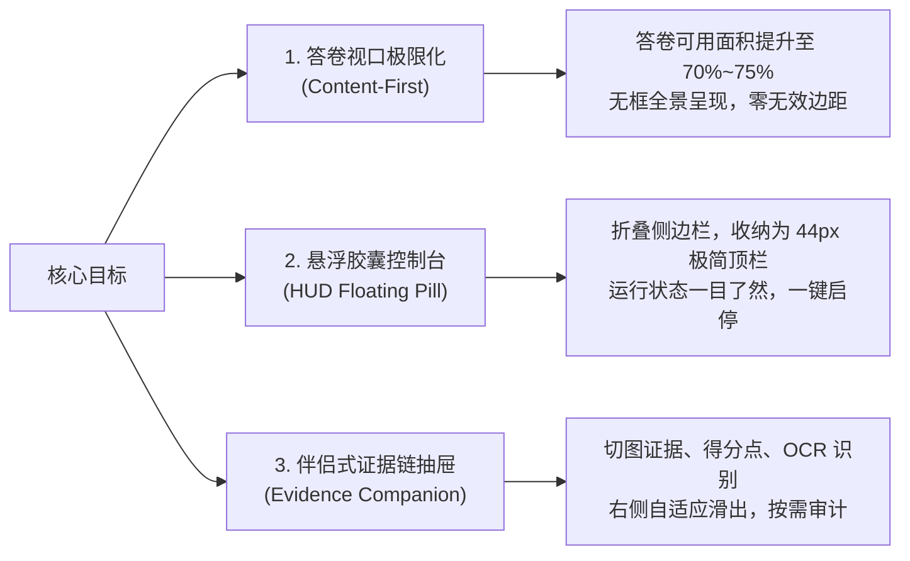

# 《衡准 · 物理阅卷工作台》界面重构设计方案与美学标准白皮书
> **面向对象**：产品经理、UI/UX 设计师、ChatGPT / Claude 等大模型 Prompt 指令、前端开发团队  
> **文档版本**：v2.0 · 2026 旗舰版  
> **核心使命**：将传统“局促、挤压、填表式”的本地桌面改卷软件，蜕变为**极客级、高沉浸、暗场抗疲劳、毫秒级证据链回放的下一代 AI 阅卷工作台**。

---

## 目录
- [一、 核心设计目标与产品愿景 (Design Goals)](#一-核心设计目标与产品愿景-design-goals)
- [二、 应当参考的顶级对象与设计精髓 (Benchmark References)](#二-应当参考的顶级对象与设计精髓-benchmark-references)
- [三、 视觉美学标准与设计系统规范 (Aesthetic Standards)](#三-视觉美学标准与设计系统规范-aesthetic-standards)
  - [3.1 色彩哲学与暗场抗疲劳系统](#31-色彩哲学与暗场抗疲劳系统)
  - [3.2 字体排版与数学公式渲染阶梯](#32-字体排版与数学公式渲染阶梯)
  - [3.3 空间网格、微质感与毛玻璃层次](#33-空间网格微质感与毛玻璃层次)
  - [3.4 动效与交互微反馈规范](#34-动效与交互微反馈规范)
- [四、 核心模块重构方案设计细则 (Module Specifications)](#四-核心模块重构方案设计细则-module-specifications)
- [五、 可直接提供给 ChatGPT / AI 的设计指导指令 (Prompt Template)](#五-可直接提供给-chatgpt--ai-的设计指导指令-prompt-template)

---

## 一、 核心设计目标与产品愿景 (Design Goals)

### 1.1 核心痛点与场景认知
高中物理阅卷老师通常需要在电脑屏幕前连续工作 **8 ~ 12 小时**，面对成百上千份字迹潦草、包含复杂物理受力图与公式推导的试卷。
- **痛点 1（空间挤压）**：传统客户端常将大块屏幕分配给静态菜单、控制卡片和庞大侧边栏，导致核心的“学生手写答卷视口”严重受限，教师需要不断手动缩放和平移。
- **痛点 2（视觉疲劳）**：大面积高饱和白色刺眼背景、杂乱无序的色块、突兀的红叉导致眼睛干涩、认知负荷极大。
- **痛点 3（信任缺失）**：AI 判定分数时如果只展示一个“总分”或一段模糊文字，教师不敢放行；必须让“卷面手写切片、扣分点、逻辑争议”与打分**并列即时呈现**。

### 1.2 三大核心设计目标



1. **答卷视口极限化（Content-First & 0-Chrome）**：
   - 界面上所有装饰性边框、多余层级必须退让。真实验卷网页或原图占据 **70%~75%** 以上的核心屏幕区域，让教师看清每一笔手写受力分析与下标。
2. **悬浮式 HUD 胶囊交互（Floating HUD Capsule）**：
   - 将原先笨重杂乱的左侧大抽屉、上层设置栏，重构为类似 macOS 动态岛或 Raycast 的**顶部悬浮胶囊**（高度 ≤ 44px）。仅露出核心：当前批卷进度、当前分值、站点探针绿灯、主运行/暂停键。
3. **伴侣式证据链与小题切片抽屉（Evidence Companion）**：
   - 不再让复杂的评分明细遮挡答卷；右侧提供可随时收折的 280px~360px 证据伴侣抽屉，精准并列展示：**手写局部高清切图**、**教师模型扣分裁决**、**置信度指示灯**与**原始转录对照**。

---

## 二、 应当参考的顶级对象与设计精髓 (Benchmark References)

为打造真正世界级的产品体验，建议在 UI/UX 与工程落地时深度借鉴以下标杆产品：

| 标杆对象 | 对应产品形态 | 我们应当学习的核心精髓 |
| :--- | :--- | :--- |
| **Linear** | 极客级项目协作客户端 | • **极致的键盘优先理念**（Space 启停、J/K 切换、Esc 返回）<br>• **Subtle 1px 细线边框**（`rgba(255,255,255,0.08)`）取代重阴影<br>• **暗场 Obsidian 质感**：极具呼吸感的灰黑梯度与专业感<br>• **微交互响应**：输入焦点、状态切换均在 150ms 优雅回弹 |
| **Raycast / Arc Browser** | 浮动命令中心与沉浸式浏览器 | • **Floating Pill 胶囊布局**：将控制系统悬浮在视口之上，而非切分视口<br>• **状态感知呼吸灯**：使用微光脉冲（Pulse Glow）表达 AI 心跳与连通状态<br>• **渐进式展开（Progressive Disclosure）**：日常只有 5% 的视觉噪音，需要时一键展开全部细节 |
| **Figma / Adobe Lightroom** | 专业画布与检视器 | • **高清切片对比检视**：右侧检查器（Inspector）与左侧原画面的联动高亮<br>• **数值微调手感**：分数调整、复核覆盖（Override）具有即时反馈与撤销提示<br>• **视网膜级锐度**：暗色背景下学生手写笔迹反差自动增强 |
| **PACS 医疗影像工作站** | 放射科/病理学诊断系统 | • **证据链零丢失原则**：每一个判决必有对应的坐标切图与原始审计链<br>• **零歧义视觉警报**：用稳重耐看的 Amber（琥珀黄）表示疑似复核，避免大红大紫造成心理恐慌 |

---

## 三、 视觉美学标准与设计系统规范 (Aesthetic Standards)

### 3.1 色彩哲学与暗场抗疲劳系统

> [!IMPORTANT]
> 拒绝使用高纯度纯黑（`#000000`）或粗暴的纯白（`#FFFFFF`）。使用精密调配的**深曜石色（Obsidian Slate）**梯度，辅以精准的物理语义功能色。

#### 背景与表面色梯度（Surface Hierarchy）
* **Canvas 深空基底**：`#0B0D12`（最底层窗口底色，沉静、深邃）
* **Viewport 答卷容器**：`#12151D`（微抬升表面，与外部边框形成柔和层次）
* **Capsule 悬浮胶囊底色**：`rgba(22, 27, 38, 0.82)` 配合 `backdrop-filter: blur(16px)`
* **Card/Drawer 抽屉卡片**：`#181C26`（承载切片图与文字，高可读性）
* **Elevated Hover 悬浮态**：`#202634`（交互时的微高亮）

#### 语义功能色（Semantic Accents）
```
Emerald (全对/运行中)   : #10B981 | 边框: rgba(16, 185, 129, 0.3) | 背景: rgba(16, 185, 129, 0.1)
Amber (待复核/疑点)     : #F59E0B | 边框: rgba(245, 158, 11, 0.3) | 背景: rgba(245, 158, 11, 0.1)
Rose (扣分/异常终止)   : #F43F5E | 边框: rgba(244, 63, 94, 0.3)  | 背景: rgba(244, 63, 94, 0.1)
Indigo (AI推理/模型态)  : #6366F1 | 边框: rgba(99, 102, 241, 0.3) | 背景: rgba(99, 102, 241, 0.1)
Cyan (站点探针/连通)    : #06B6D4 | 边框: rgba(6, 182, 212, 0.3)  | 背景: rgba(6, 182, 212, 0.1)
```

---

### 3.2 字体排版与数学公式渲染阶梯

- **英文/数字主字体**：`Inter`, `-apple-system`, `BlinkMacSystemFont`, `sans-serif`
- **代码/数值显示（Tabular Nums）**：`JetBrains Mono`, `Consolas`, `monospace`（确保分值、耗时、坐标对齐不跳动）
- **中文字体栈**：`PingFang SC`, `Microsoft YaHei UI`, `Noto Sans SC`, `sans-serif`
- **公式符号**：原生嵌入 **KaTeX**，保证分式 $\frac{GMm}{r^2} = m\frac{v^2}{r}$ 与希腊字母 $\mu, \theta, \lambda$ 呈现印刷级清晰度。

#### 排版字阶（Type Scale）
1. **Hero HUD 分数**：`32px` / `line-height: 1` / `font-weight: 700`（如 `16 / 16`）
2. **一级标题/关键状态**：`15px` / `font-weight: 600` / `color: #F1F5F9`
3. **正文与手写转录**：`13px` / `line-height: 1.6` / `color: #CBD5E1`
4. **小题题号与元信息**：`12px` / `font-weight: 500` / `color: #94A3B8`
5. **审计微标（Badge）**：`11px` / `font-weight: 600` / `letter-spacing: 0.5px` / `text-transform: uppercase`

---

### 3.3 空间网格、微质感与毛玻璃层次

- **Hairline 细线边框原则**：全面剔除 2px 以上的厚笨边框，统一切换为 `1px solid rgba(255, 255, 255, 0.07)`。在卡片高光面可叠加 `border-top: 1px solid rgba(255, 255, 255, 0.12)` 产生精巧的倒角高光。
- **圆角体系（Radii）**：
  - 悬浮胶囊：`rounded-full` 或 `32px`
  - 核心视口与抽屉面板：`12px`
  - 内嵌切片图卡片与评分点：`8px`
  - 小型标签 Badge：`4px`
- **高阶内阴影（Inner Ambient Shadow）**：
  - 容器卡片使用内发光模拟物理金属/玻璃切面：`box-shadow: inset 0 1px 0 rgba(255, 255, 255, 0.08), 0 8px 24px rgba(0, 0, 0, 0.4)`。

---

### 3.4 动效与交互微反馈规范

1. **缓动曲线（Apple Smooth Easing）**：
   - 全局过渡使用：`transition: all 200ms cubic-bezier(0.16, 1, 0.3, 1)`。
2. **呼吸微光（Status Pulse）**：
   - 处于自动批改中时，运行指示点不仅变绿，还附带细腻的扩散呼吸环：
   ```css
   @keyframes pulse-ring {
     0% { transform: scale(0.95); opacity: 0.8; }
     50% { transform: scale(1.4); opacity: 0; }
     100% { transform: scale(0.95); opacity: 0; }
   }
   ```
3. **切片灯箱无缝平滑放大（Hero Layout Motion）**：
   - 点击小题局部切图时，通过平滑的局部展开飞入中央大图检视，保持视觉注意力不跳跃。

---

## 四、 核心模块重构方案设计细则 (Module Specifications)

### 4.1 总体视口网格切分（72% 验卷 + 28% 证据伴侣）

```
+-----------------------------------------------------------------------------------------+
| [● 衡准] [智学网: 已就绪 ●]  [批改中: 第 14/120 份]  [当前: 16分]  [ Space 暂停 ]  [设置/日志] | <-- 悬浮顶栏 (44px)
+-------------------------------------------------------------+---------------------------+
|                                                             | [证据伴侣抽屉: 展开 / 收起]  |
|                                                             |                           |
|                                                             | ● 第 (1) 问 [ 3 / 3 分 ]   |
|                 真实验卷 / 答题卡嵌入式视口                   |   [局部切片: R=12.0Ω]     |
|                                                             |   ✔ 最终答案正确 (快速通道)  |
|               (Webview / Electron BrowserView)              |---------------------------|
|                                                             | ▲ 第 (2) 问 [ 2 / 5 分 ]   |
|            保留 100% 原汁原味网页排版，无遮挡输入框            |   [局部切图: 步骤涂改处]    |
|                                                             |   -2 漏写方向判定公式      |
|                                                             |   置信度: 0.94 [需复核]    |
|                                                             |---------------------------|
|                                                             | 实时流水线审计日志 (极简滚动)|
+-------------------------------------------------------------+---------------------------+
| 快捷键提示: [Space] 启停流水线 | [Tab] 切换抽屉 | [Esc] 关闭弹窗 | [R] 强制重审当前份          |
+-----------------------------------------------------------------------------------------+
```

---

## 五、 可直接提供给 ChatGPT / AI 的设计指导指令 (Prompt Template)

如果你需要将此设计规范投喂给 ChatGPT、Claude 或其他 AI 编码助手，请直接复制下方 Prompt：

````markdown
# Role & Mission
你是一位精通 Linear、Raycast、Figma 视觉风格的高级前端架构师与 UI/UX 设计专家。
请根据以下设计白皮书，重构《衡准 · 物理改卷工作台》的界面：

## 1. 核心设计哲学
- **极简主义与内容优先 (Content-First)**：主视口必须留给学生手写答卷（占 70%~75% 面积），严禁笨重大侧边栏或层层嵌套卡片挤占答卷空间。
- **暗场 Obsidian 美学 (Dark Pro Theme)**：使用 #0B0D12 基底、#12151D 表面色、1px 细线边框 (rgba(255,255,255,0.07))，提供 8 小时连续阅卷不刺眼的护眼环境。
- **HUD 悬浮胶囊控制台**：顶部导航栏高度严格限制在 44px 以内，采用微磨砂玻璃拟态，呈现极简运行状态（运行状态指示灯、进度、分值、启停主控按钮）。
- **右侧证据伴侣抽屉**：以卡片化方式呈现小问得分、局部高清手写切片（含红框标注）、扣分原因和置信度，支持流畅收起与展开。

## 2. 技术栈与实现约束
- 采用 React 19 + TypeScript + Tailwind CSS / 现代化 CSS 变量。
- 数值与状态必须严格单点对齐（font-variant-numeric: tabular-nums）。
- 所有物理公式渲染必须通过 KaTeX 无缝嵌入。
- 动效遵循 cubic-bezier(0.16, 1, 0.3, 1)，过渡时间在 150ms ~ 250ms 之间，严禁生硬卡顿。

请按照上述标准产出符合工业级标准的页面代码与交互逻辑。
````

---
> *本设计规范书由衡准团队深度研发制定，作为全自动物理阅卷系统的视觉与交互终极基线。*
