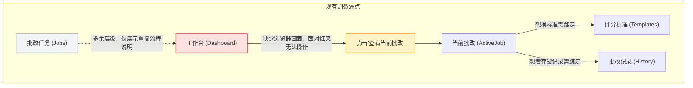
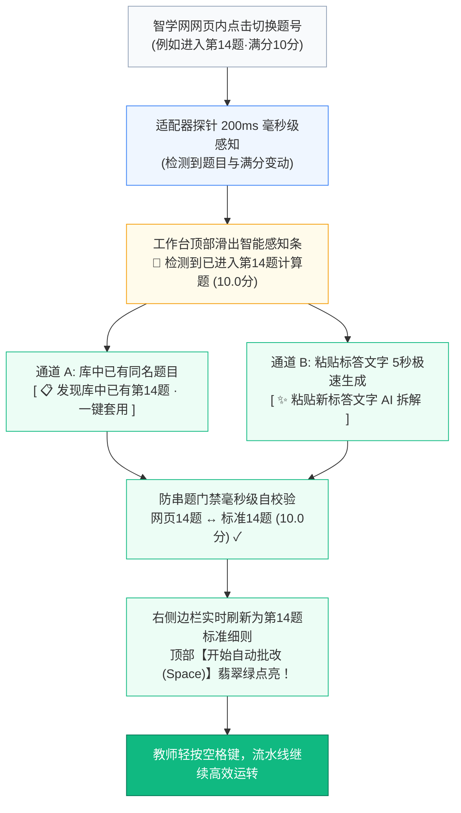
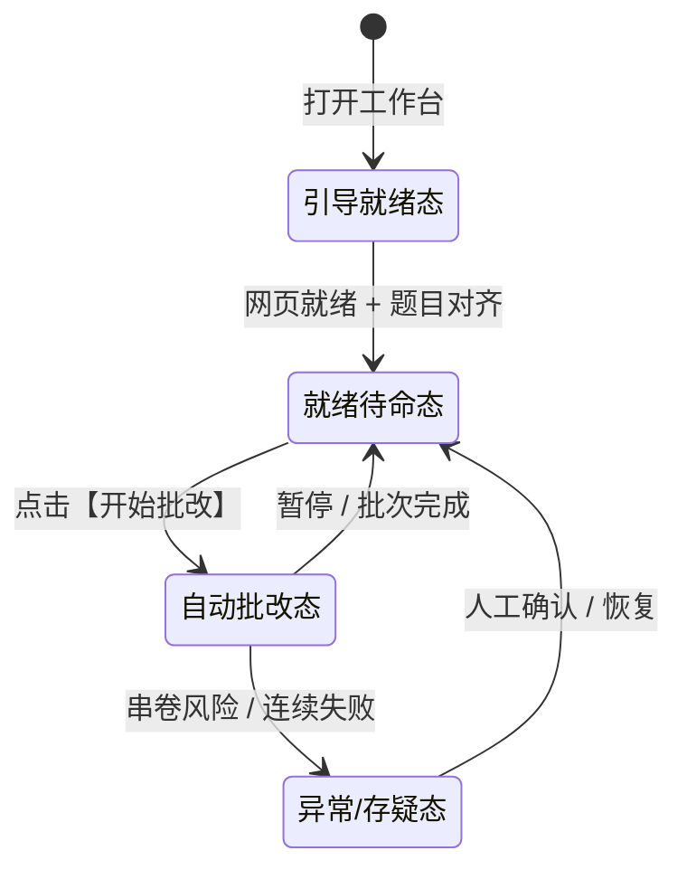

# 衡准 · 全新一代智能阅卷工作台（All-in-One Workbench）重写设计方案

> **设计基准**：彻底终结“概念分散、盲盒排错、信息割裂、操作繁琐”的现状，打造一个**以真实阅卷场景为核心、所见即所得、零心智负担**的高中物理 AI 全自动改卷沉浸式驾驶舱。

---

## 一、 现状病灶深度剖析：现有工作台为什么“十分难用”？

结合您提供的截图及系统当前实现，现有工作台存在 **5 个根本性体验死穴**：



### 1. 概念碎片化与导航重叠：三个功能重叠的页面让教师晕头转向
- 侧边栏目前并存 **“工作台”** (`/dashboard`)、**“批改任务”** (`/jobs`)、**“当前批改”** (`/jobs/current`)：
  - 教师进入“工作台”，以为可以开始改卷，结果只是一个冷冰冰的检查列表；
  - 点进“批改任务”，里面只是一个“新建引导”与静态说明流程图；
  - 必须一路点进“当前批改”，才看到内嵌浏览器与流水线控制按钮。
- **结论**：对一线改卷教师而言，**“工作台”就是“改卷场”**。强行拆分为三个页面纯属过渡期架构遗留，造成了严重的割裂与多余点击。

### 2. 脱离现场的“盲盒排错”（截图最大痛点）
- 在截图呈现的“工作台”中：
  - 检查清单标红：`学生答卷可以读取 ❌`、`最终总分框可以使用 ❌`；
  - 但页面上**完全没有内嵌浏览器画面**，教师无法知道是“未打开智学网”、“未登录”、“在考试列表页”、“还是没点进第13题”。
  - 教师只能看到右下角小字堆砌着原始日志：`未找到智学网阅卷子页面; 无法生成智学网当前答卷的稳定页面标识...`
- 教师不是运维开发，这种把底层爬虫/控件探测的失败堆栈直接扔给用户的做法，造成了极强的挫败感和失控感。

### 3. 工程师思维过重，核心业务要素让位于开发调试
- 截图中占据视觉黄金 C 位的居然是：
  - 一长串无意义的 UUID 模板编号（`211deccf-3d0f-4d64-8e30-01ca83e560c9`）；
  - 巨大的绿色调试横幅：“无需配置端口：先用本地模拟阅卷验证流程”（生产环境下教师根本不需要天天看这个，严重误导操作）；
- 而教师真正关心的**“我当前改的是哪套卷子哪道题”**、**“目标网页停在什么位置”**、**“怎么一键开改”**反而被挤压。

### 4. 批改过程与结果反馈缺乏伴侣感（无实时给分审计）
- 流水线在后台批改时，现在的界面仅有顶上一小行进度条和干瘪的数字（已批改 0）。
- 教师无法在工作台直观看到：
  - **刚刚批完的这份答卷得了几分？各小问给分情况如何？**
  - **AI 判错的依据是什么？切片在哪里？**
  - **哪些答卷被打了“优”标记（存疑待复核）？**
- 教师若想检查刚才批改的质量，必须中断或跳出页面去“批改记录”里翻找，无法实现“一边看着自动走、一边抽查刚刚判的分”。

### 5. 屏幕利用率低，多分辨率下布局极其局促
- 现有 `ActiveJobPage` 强制在左侧固定 340px~390px 评分标准面板，右侧强塞浏览器。
- 在主流 1080p 笔记本（带 125%/150% 系统缩放）上，智学网/睿芽云原本宽阔的评卷页面被压缩至 800px 以下，导致网页内部表格挤压、必须左右拖动滚动条，改卷体验极差。

---

## 二、 全新重构核心理念：一体化改卷驾驶舱（All-in-One Workbench）

```
┌─────────────────────────────────────────────────────────────────────────────┐
│ 衡准 · 智能阅卷一体化工作台 (All-in-One Workbench)                           │
├─────────────────────────────────────────────────────────────────────────────┤
│ 1. 唯一核心工作场：干掉冗余导航，工作台 = 阅卷现场 + 状态控制 + 实时结果     │
│ 2. 所见即所得：内嵌浏览器常驻主视口，指引、状态与报错全部直观叠加于现场     │
│ 3. 智能就绪门禁：自动检测 绑定标准 ↔ 网页题目 ↔ 登录状态，绿灯一键起飞    │
│ 4. 伴侣式实时反馈：改卷流水线前进时，侧边自动流转展示最新批改卡片与存疑切片 │
│ 5. 灵活空间布局：一键自适应切换【双重视口】、【全屏沉浸】与【抽屉对比】     │
└─────────────────────────────────────────────────────────────────────────────┘
```

---

## 三、 全新导航与信息架构（IA）

彻底精简侧边栏，从 10 个层级缩减为清晰明了的 3 大模块：

| 模块 | 现有混乱结构 | **重构后精炼结构** | 说明 |
|---|---|---|---|
| **核心作业** | 1. 工作台 (`/dashboard`)<br>2. 批改任务 (`/jobs`)<br>3. 当前批改 (`/jobs/current`) | **🎯 智能工作台 (`/workbench` 或 `/`)** | **三合一终极整合**：内嵌浏览器视口 + 快捷控制台 + 实时批改结果流 |
| **资料管理** | 4. 评分标准 (`/templates`)<br>5. 批改记录 (`/history`) | **📋 评分标准**<br>**📊 批改记录与复核** | 评分模板管理；历史批改详情与存疑答卷的人工二次复核 |
| **系统设置** | 6. 运行日志<br>7. 教师模型<br>8. 浏览器诊断<br>9. 插件诊断<br>10. 应用设置 | **⚙️ 教师模型与规则**<br>**🛠️ 系统设置与诊断** (含日志/插件) | 合并技术诊断，将开发模式下沉，把界面还给一线教学 |

---

## 四、 全新工作台界面布局与线框设计

全新工作台采用**“沉浸式顶通态势栏 + 自适应主副分屏 + 浮动抽屉”**的黄金布局：

```
+---------------------------------------------------------------------------------------------------------+
| [衡准 LOGO]  当前任务: [高三物理期中·第13题 实验题 (6分) ▾]  |  智学网: [已定位到第13题 (就绪) ●]       |
|                                                                                                         |
| 快捷统计: [ 已批改 42 份 ] [ 均分 4.2 ] [ 待复核 2 份 (优) ⚠️ ]  |  [ ▶ 开始自动批改 (Space) ] [ ⏸ 暂停 ] [ ⏹ 停止 ] |
+---------------------------------------------------------------------------------------------------------+
|                                                      |                                                  |
|                   主视口 (65%~100%)                  |                智能伴侣视口 (35%~0%)              |
|               目标阅卷平台 (智学网 / 睿芽云)           |           (支持快捷折叠 / 展开 / 浮动抽屉)        |
|                                                      |                                                  |
|  +------------------------------------------------+  |  [ 📑 评分标准 ] [ ⚡ 实时批改流 (当前) ] [ ⚠️ 存疑待办 ] |
|  |  目标阅卷系统内嵌页面 (清晰大视口)              |  |  ----------------------------------------------  |
|  |                                                |  |  【最新答卷批改结果 (第 42 份)】                  |
|  |  [ 学生手写答卷图片呈现区 ]                      |  |  得分: 5.0 / 6.0 分   (耗时 2.1s)                |
|  |                                                |  |  • 第(1)问: 2.0/2.0 分 [满分]                     |
|  |                                                |  |  • 第(2)问: 1.0/2.0 分 [扣1分: 未保留2位有效数字]  |
|  |                                                |  |    [查看手写切片证据 🔍]                           |
|  |  [ 评分打分框 ]  [ 提交并下一份 ]               |  |  • 第(3)问: 2.0/2.0 分 [满分]                     |
|  |                                                |  |  ----------------------------------------------  |
|  |                                                |  |  【待复核答卷快捷队列 (2)】                        |
|  +------------------------------------------------+  |  [第38号: 涂改存疑·3分] [第19号: 切片截断·0分]    |
|                                                      |                                                  |
|  [ 页面操作微工具: 刷新 / 后退 / 截图 / 诊断 ]       |  底线审计: 后端权威重算已锁定 · 防串卷校验通过    |
+---------------------------------------------------------------------------------------------------------+
```

### 1. 顶部驾驶舱态势栏（Top Cockpit Bar）
把所有的核心操作汇聚在顶部，视线高度聚焦：
- **任务/标准选择器**：高亮显示当前试卷题目（如 `高三第一学期月考 · 第13题 实验题 (满分6分)`），支持原地快速下拉切换标准，无需跳出页面。
- **题目对齐与站点状态指示器**：
  - 绿灯常亮：`智学网已连接 · 当前网页正是第13题 (安全校验通过)`
  - 黄灯提示：`已连接智学网，但尚未进入第13题评阅界面 (请在下方操作)`
  - 红灯阻断：`防串题保护拦截：网页为第12题，当前标准为第13题！`
- **批改控制枢纽（大尺寸醒目按钮）**：
  - 【开始自动批改】（采用高对比翡翠绿大按键，支持键盘快捷键 `空格键` 一键起停）；
  - 【暂停】、【停止】；
  - 自动运行统计气泡：`已自动批改 42 份`、`均分 4.2 分`、`存疑 2 份`。
- **视口自适应切换器**：
  - `[分屏对比]`（默认）：左侧浏览器，右侧伴侣面板；
  - `[专注网页]`：浏览器占满 100%，右侧收缩为极简悬浮状态胶囊；
  - `[结果看板]`：右侧伴侣面板展开，方便集中核验批改明细。

### 2. 左侧主视口：真实现场与交互式智能引导
- **彻底告别脱节的文字报错**：
  - 当页面未就绪时（如截图中的 2/4 状态），**直接在浏览器视口上方叠加轻量级浮层引导卡片**：
    - 若未登录智学网 ➔ 浮层提示：`“请在下方网页完成智学网账号登录”`
    - 若在考试列表 ➔ 浮层提示：`“请点击您要批改的试卷，并进入第 13 题批阅页面”`
    - 若一切就绪 ➔ 浮层瞬间收起，顶部【开始自动批改】按钮泛光点亮！
- 教师的所有前置动作都在这一个窗口内直接点点鼠标完成，**绝对不需要在多个页面来回切换**。

### 3. 右侧智能核对伴侣视口（支持三模式自由切换与试水批改）

根据一线教师核心阅卷诉求：**工作台必须支持随时查验原题、核对评分细则，并实时展示最新一份答卷的手写切片与得分结果；同时支持单卷安全试水与非侵入式轻量通知**。

伴侣视口常驻于主工作台右侧（宽度 360px~390px，支持顶部按钮或快捷键 `R` 一键平滑折叠/展开），顶部分段控制器支持在**三个核心模式**之间秒级切换：

#### 3.1 模式一：题目原文（Question Inspector - 原题题干核对）
- **完整物理题干**：清晰排版呈现气垫导轨、滑块、沙桶、光电门等物理实验模型背景文字与公式（LaTeX / KaTeX 高清渲染）；
- **逐小问完整提问**：列出每个小问的题意、待填空位置及 A/B/C 备选选项，方便教师核对学生是否曲解了题意。

#### 3.2 模式二：评分标准（Rubric Inspector - 判分细则依据）
- **头部态势与分值**：高亮显示 `当前评分标准`、`第13题 物理实验题` 及总分 `6 分`（翡翠绿数字徽章），并支持一键收起；
- **逐小问折叠卡片（Accordion Hierarchy）**：
  - **小问主卡片**：显示 `1 · (1) 2分`、`2 · (2) 2分`、`3 · (3) 2分`，右侧带折叠箭头与评分点计数；
  - **评分点编号与分值**：清楚列出 `1-1 (2分)`、`2-1 (2分)` 等；
  - **判分依据高亮区（Expected Value Area）**：采用翡翠绿半透浅底（`#e8f8f6`）与深绿左侧重音线（`border-l-3 #0e9f98`），突出显示教师设定的标答；
  - **有效数字与扣分特别警告**：例如在第(2)问明确醒目标注：*“填入 2.4。必须严格保留两位有效数字，未保留两位有效数字（如写成 2、2.40、12/5 等）不得分”*，人工核对时一目了然；
  - **作答形式辅助抽屉（Form Guidance）**：折叠展开，支持说明大小写字母、括号、单位（如 `m/s²`）等容错范围；
- **版本审计底栏**：常驻显示当前评分标准版本号（如 `v1.0 (已锁定)`）及 `与智学网第13题已对齐 ✓` 安全凭证。

#### 3.3 模式三：批改结果（Latest Grading Result - 最新记录极简看板）
针对教师“快速核验 AI 判分是否准、切片有没有切对”的诉求，**只保留最核心的审计要素，绝不堆砌冗余参数**：
1. **本题总分卡片**：醒目呈现 `本题权威重算总分: 5.0 / 6.0 分`，标明 `已填入智学网框 (未提交)`，附带耗时（2.1s）与总体置信度（0.98）；
2. **逐小问简洁记录列表**：
   - **小问 (1)**：标题 `验证平衡摩擦力` ➔ 最终得分 `2.0 / 2.0 分` (满分) ➔ **手写切片图片仿真呈现**：提取出学生实际书写的 `间距相等` 高清切片；
   - **小问 (2)**：标题 `计算加速度大小` ➔ 最终得分 `1.0 / 2.0 分` (扣1分) ➔ **手写切片图片仿真呈现**：提取出学生实际书写的 `a = 1.4 m/s²`，并高亮标注扣分原因：*“标答应保留两位有效数字 (1.40)，未保留扣 1.0 分”*；
   - **小问 (3)**：标题 `a-1/M 图像形态` ➔ 最终得分 `2.0 / 2.0 分` (满分) ➔ **手写切片图片仿真呈现**：提取出学生实际书写的 `过原点的倾斜直线` 切片。
3. **审计追溯凭证**：底栏显示 `call_id: c_78a1bc` 与模型调用元数据，确保每次判分可溯源。

#### 3.4 网页内“试水批改”按钮（Dry-Run: 仅填分·不提交）
- 在网页内嵌视口的打分侧栏常驻醒目试水按键：**【🧪 试水批改本题 (仅填分·不提交)】**；
- **运行机制**：系统提取当前学生答卷图像，完成多模态视觉模型判分与计分引擎权威重算，**将计算得出的总分（如 5.0 分）精准写入网页输入框，但绝对不点击网页提交按钮、不翻页**；
- 试水完成后，右侧伴侣视口自动秒切至【批改结果】模式，方便教师肉眼核对识别切片与得分是否合情合理。

#### 3.5 应用内右下角轻量气泡通知（In-App Toast Notification）
- **非侵入式设计**：批改每完成一份答卷，自动在应用内右下角弹出轻量悬浮气泡（**绝对不是独立系统弹窗，不遮挡主视口任何工作区域**）；
- **核心信息呈现**：展示 `✓ 本题批改完成！5.0 分`、耗时、三小问极简分值胶囊；
- **10 秒自动消失倒计时**：气泡底栏带 10 秒线性平滑收缩进度条，并在右上角显示 `10s` 倒计时与 `×` 快捷关闭按钮；
- **一键点击直达详情**：教师点击气泡任何区域，系统立即展开右侧伴侣面板并切到【批改结果】，高亮聚焦切片与判分理由！

### 4. 工作台“双模态”自适应架构（新手向导态 vs 生产驾驶舱态）

工作台具备自感知能力，根据用户环境的就绪程度无缝切换两种呈现模式：

```
+---------------------------------------------------------------------------------------------------------+
| [模式 A] 新手向导态 (未配置/资料不全时)                | [模式 B] 生产驾驶舱态 (全部就绪后)                     |
|                                                         |                                                         |
| 1. 左侧：渐进式四步前置配置面板 (原地填Key/选标准/测连通) | 1. 顶部：极简全功能控制条 (一键起停/对齐校验/快速统计)  |
| 2. 右侧：常驻目标浏览器 (指导用户登录智学网与进题)      | 2. 左侧：全尺寸真实验卷浏览器 (清晰大视口)              |
| 3. 四步全绿时，一键触发“开启自动批改”丝滑平移至模式 B   | 3. 右侧：智能伴侣面板 (实时判卷流/评分细则/存疑待办抽屉)|
+---------------------------------------------------------------------------------------------------------+
```

---

## 五、 新用户从 0 开始配置全流程设计（Zero-to-One Onboarding）

解决新用户“首次使用完全摸不着头脑”、“被逼在五六个页面间跳转填表”的核心方案：**将全套前置准备内化为工作台主场的 4 步渐进式就绪卡片流水线**。


### 第一阶段：沙盒试飞破冰与完整证据链体验（零门槛无风险，建立信任）

大厂成熟产品的精髓在于**“先让用户在 30 秒内零成本看到令人震撼的核心价值（Aha! Moment），再引导其完成外部环境配置”**：

#### 1. 默认进入模拟虚拟改卷沙盒（免登录 · 开箱即用）
- **痛点反思**：如果新用户一打开软件就必须面对真实的智学网账号密码、扫码验证码，甚至在繁琐的考试列表中找卷子，一旦网络或登录受阻，连 AI 的影子都没见到就会彻底放弃；
- **全新范式**：首次打开工作台，视口默认加载官方内置的**“衡准虚拟改卷沙盒”**。沙盒中已装载了一份典型的高中物理手写答卷样本（第 13 题 验证牛顿第二定律实验题，满分 6.0 分），原图、答题字迹与输入框清晰可见，零门槛、零风险！

#### 2. 引导配置大模型 API Key（唤醒大脑）
- 聚光灯聚焦于顶部【AI模型胶囊】，气泡原地展开：
  - **DeepSeek 直连（推荐）**：只需填写 Key 与模型名，开箱即用；
  - **自定义 API 服务**：支持填写私有 Base URL（如 SiliconFlow / 智联 / Ollama 等）；
- 点击【测通连通性 (Enter)】，300ms 完成真实连通测试并点亮翡翠绿【已激活】胶囊，自动放行下一步。

#### 3. 评分标准已官方内置就绪（免去初次繁琐编辑）
- **零负担设计**：初次使用绝不逼迫教师去手动拆解或输入复杂的评分细则；
- 系统已为您预装并锁定了官方标准《第13题 验证牛顿第二定律》完整评分细则（总分 6.0 分）：
  - `1·(1)` 调节倾角使点迹间距相等 (2.0分)；
  - `2·(2)` a=1.40m/s² (2.0分，**包含“未保留两位有效数字扣1分”的严查规则**)；
  - `3·(3)` a-1/M图像为过原点倾斜直线 (2.0分)；
- 右侧核对伴侣视口已同步展开细则卡片，教师一眼便知规则已就绪，直接进入下一步！

#### 4. 一键体验沙盒批改 ➔ 完整证据链与手写切片全景展现（Aha! Moment）
- 聚光灯聚焦在开始按钮与沙盒体验按钮上；
- 教师轻按键盘**空格键 (Space)** 或点击按钮：
  - AI 在 500ms 内完成视觉转录、按小问定位与逐点裁决；
  - 沙盒总分框回填 **5.0 分**，原图手写切片高亮框依次展开；
  - 右侧核对伴侣视口自动切换到**【批改结果】**模式并高亮：
    - **总分**：`5.0 / 6.0 分`；
    - **第(1)问**：2.0 分 [满分]（手写切片 `[间距相等]`）；
    - **第(2)问**：1.0 分 [扣1分: 未保留2位有效数字]（手写切片 `[a = 1.4 m/s²]`，扣分依据清晰可见）；
    - **第(3)问**：2.0 分 [满分]（手写切片 `[过原点的倾斜直线]`）；
  - 右下角滑出 **10 秒轻量倒计时通知气泡**；
- 教师亲眼见证了 AI 不仅能打分，更能精准捕捉细微扣分点并给出高清手写切片证据，建立起对衡准系统的强大信任！导览气泡提示完成，点亮【下一步: 接入真实网站配置 ›】。

---

### 第二阶段：接入真实网站配置（智学网 / 睿芽云平滑接入）

体验完惊艳的沙盒能力后，导览引导教师跨入真实生产考场：
1. **视口平滑过渡**：点击下一步，中央视口平滑淡出沙盒，优雅切入真实智学网登录页面，激光雷达扫描动效启动；
2. **自主登录与进题**：教师在下方网页自主扫码/输入账号密码登录智学网，并进入本次要评阅的物理试题；
3. **实时探针与硬门禁控制**：
   - 系统适配器（`zhixueAdapter.ts`）在后台毫秒级探测 DOM：
     - `考生答卷原图提取`：检测到有效高保真学生答卷图片；
     - `总分打分框写入`：检测到智学网总分输入框（支持写入并回读）；
     - `翻页与提交控件`：检测到下一份/提交按钮。
   - **【严格硬门禁】**：未检测到完整就绪控件前，主控按钮保持安全锁定；
   - 探测就绪瞬间：视口散发翡翠绿扩散水波纹动效与微粒子，主控绿色按钮【开始自动批改 (Space)】彻底点亮，正式开启真实考生的全自动流水线批改！

---

## 六、 第二次及日常使用链路设计：换题与新标准极速流转（Day-2 & Routine Grading Flow）

### 6.1 教师日常心智模型与痛点突破
完成首批次改卷后，教师已建立对系统的基本信任，此时的核心心智模型是**“极速生产、绝不打扰、零跳出切换”**：
- **已有资产绝对保留**：大模型 API Key 与配置早已保存在本地安全区，无需二次填写；智学网账号登录态已被 Electron 会话持久化保持；
- **真正改变的只有两件事**：
  1. 智学网网页切换到了**新题目**（例如从第 13 题实验题切到第 14 题大计算题）；
  2. 需要为新题目匹配或生成**新评分标准**。
- **坚决杜绝的传统反模式**：
  - ❌ 绝不再弹任何新手教学聚光灯或指引遮罩；
  - ❌ 绝不在界面上抛出刺眼的红叉或报警弹窗（如“防串题保护拦截！题号不一致”）；
  - ❌ 绝不把用户踢到脱离网页的配置后台重新创建、保存、再回到工作台绑定。

---

### 6.2 主动感知与智能配对机制（Proactive Sensing & Auto-Pairing）

教师在内嵌智学网中点击“下一题：第 14 题 计算题 (满分10分)”的瞬间，工作台主动执行**“人动，系统自动跟随”**：



---

### 6.3 10秒配齐新评分标准的两条极速通道

工作台上方滑出高质感 Prism 拟态悬浮条：
`🧭 智能感知到您已切换至：第 14 题 计算题 (满分 10.0 分) · 当前标准仍为第 13 题`
悬浮条原地提供两个最高频的绿色操作按键：

#### 通道 A：历史标准库智能推荐（Smart Library Suggestion · 1 秒）
- **自动模糊匹配**：系统根据当前考试名称与题号，自动检索本地已存评分标准库；
- **智能推荐卡片**：如果发现已有历史同名标准（例如*“高三物理期中期末标答库：第14题 带电粒子在磁场中的运动”*），直接显示：
  `[ 📋 发现库中已有第14题标准 · 一键套用 ]`；
- 教师只需点击 1 次鼠标，新标准立即载入，零等待！

#### 通道 B：原地 AI 极速拆解新标答（In-Situ AI Parsing · 5 秒）
- 针对手头只有试卷文档或微信群标答文字的场景：
  - 点击 `[ ✨ 粘贴标答文字 AI 拆解 ]`，原地展开极简输入框；
  - 教师直接粘贴纯文本（如：*(1) qvB=mv²/R 得 v=qBR/m (4分) (2) t=πm/qB (6分)*）；
  - 大模型在 3 秒内自动拆解为 2 小问结构与详细给分依据；
  - 教师扫一眼预览，点击“确定使用”，新标准瞬间锁定！

---

### 6.4 门禁自放行与一键点火（Ready to Fire）

1. **防串题自动校验通过**：
   - 系统瞬间完成对齐校验：`网页第14题 (10.0分)` ↔ `新标准第14题 (10.0分)`，安全绿标常亮；
2. **悬浮条优雅隐退**：
   - 智能悬浮条转为绿色对勾 `✓ 题号与满分对齐成功`，随后优雅收起，绝不遮挡视线；
3. **右侧核对伴侣视口瞬时同步**：
   - 右侧伴侣视口的【评分标准】卡片即时刷新为第 14 题的两小问细则（小问(1) 4分、小问(2) 6分）；
4. **主控大按键重新激活**：
   - 顶部翡翠绿大按键【开始自动批改 (Space)】瞬间点亮脉冲；
   - 教师轻按键盘**空格键**，直接进入第 14 题的全自动流水线批改，全过程切换耗时不到 10 秒！

---

### 6.5 新建评分标准深度重塑：侧栏整页主场创建 ➔ 确认保存后自动携标返回工作台

#### 1. 彻底颠覆“局促小弹框”的反直觉设计
- **痛点反思**：高中物理评分细则非常严肃且信息密度极高（涉及长篇题干背景、分小问推导、LaTeX 物理公式、有效数字严查要求等）。过去在工作台上弹出一个狭小的小框或局促抽屉进行编辑，教师不仅看不全题目上下文，而且容易产生强烈的逼仄感与误操作；
- **全新范式（主场分离，各司其职）**：
  - **`🎯 工作台` 主场**：专注全自动批改执行、网页控件监控与批改切片核对；
  - **`📋 评分标准` 主场**：作为管理、创建、微调评分细则的**全屏专业主场**（与桌面端历史资产库与用户真实截图 100% 视觉对齐）。


#### 2. 全屏三步式评分标准编辑器架构
进入侧栏【评分标准】后，点击新建即可展开无遮挡全屏编辑器：
- **步骤 1：导入题目与参考依据**：
  - 宽阔的双栏编辑器：左侧输入题目原文（支持文字/截图拖拽），右侧输入参考答案与评分标准（支持 LaTeX 物理公式输入与即时渲染）；
  - 链路模式胶囊：支持一键指定【大题 (AI视觉分阶段/原生链路)】或【小题 (分空切片盲审链路)】；
- **步骤 2：评分标准草稿核对与小问细则预览**：
  - 点击“生成评分标准草稿”，模型在 2-3 秒内完成小问拆解与分步给分依据提取；
  - 全屏呈现各小问卡片（如 `1 · (1) 4.0分 洛伦兹力推导`、`2 · (2) 6.0分 周期与时间`），判分依据高亮展开，方便教师精细化调整；
- **步骤 3：底部吸底确认栏（自动闭环关键）**：
  - 页面底部常驻玻璃拟态吸底操作条，包含醒目的大按键：
    `[ 💾 确认保存并自动返回工作台开始批改 (Enter) ]`；
  - 支持键盘 **Enter 键（或 Ctrl+Enter）** 物理快捷保存。

#### 3. 自动回弹工作台的“零摩擦”闭环体验
保存动作绝不让用户停留在后台列表、逼迫用户自己思考“怎么返回工作台”或“去哪里绑定”：
1. **自动保存与绑定**：系统将新标准持久化入库，并在本地模板库中将该模板标记为 `✓ 已绑定当前任务`；
2. **瞬间路由平滑回切**：视图在 300ms 内自动导航回【🎯 工作台】主场，保持沉浸感；
3. **对齐门禁自放行**：工作台后台毫秒级执行题号与满分对齐门禁校验（`verifyQuestionAlignment`），确认放行；
4. **驾驶舱与伴侣视口全同步**：
   - 顶部态势栏自动刷新为新题号与满分（如 `第14题 物理计算题 · 满分10.0分`）；
   - 右侧伴侣面板自动切到【评分标准】Tab，即刻呈现刚刚保存的新细则卡片；
   - 顶部主控按键【开始自动批改 (Space)】散发翡翠绿高亮呼吸光晕；
5. **一键起飞**：教师轻按空格键，流水线无缝投入全新题目的批阅！

---

## 七、 状态机驱动的三大情景设计

整个工作台通过统一的状态机无缝驱动，教师不需要理解底层技术，界面会“感知”教师当前要做什么：



### 情境 A：空闲与未就绪态（引导式，告别红叉）
- 目标：将截图中的 4 项冷冰冰检查清单转化为动态行为指引。
- 界面行为：
  1. 顶部显示：“已选择第13题（满分6分）”；
  2. 浏览器直接展示智学网页面；
  3. 悬浮徽标温馨提示：“正在等待进入评卷页面… 请在网页中点击【开始批阅】”；
  4. 一旦教师在网页中点进批阅窗口，系统在 300ms 内检测到输入框与答卷图片，自动发出轻柔音效/高亮动效，提示“答卷已就绪，可开始批改”。

### 情境 B：自动批改进行态（沉浸式监控）
- 目标：让教师安心放手，又能时刻掌控大局。
- 界面行为：
  1. 顶部控制栏切换为：【⏸ 暂停】与【⏹ 停止】，显示实时计数器（已完成 18 份，平均 2.4s/份）；
  2. 左侧内嵌浏览器：自动化同步展示答卷切换与写分过程；
  3. 右侧智能伴侣：如同“弹幕/时间轴”一样，实时平滑滑入每一份答卷的判分简报；
  4. 若某份答卷命中存疑门禁（如字迹严重涂改），右侧伴侣面板伴随黄色微光闪烁，自动将该答卷收入“待复核抽屉”，流水线不停顿继续下一份。

### 情境 C：异常拦截态（安全兜底）
- 目标：杜绝串卷、串题风险，清晰指导人工介入。
- 界面行为：
  1. 若教师在智学网切换到了第 14 题，系统触发防串题硬门禁，立即安全暂停；
  2. 顶部弹出强提醒：“防串题保护生效：当前网页已切换至第14题，与当前绑定的第13题不一致！”；
  3. 给出两个一键操作按钮：`[一键切换为第14题评分标准]` 或 `[在网页中返回第13题]`。

---

## 六、 研发实施与落地路线图

重构工作台遵循现有 `AGENTS.md` 规范（包括计分权威、防串卷校验、TypeScript Strict 与渐进式迁移），分为三个阶段实施：


### 阶段 1：导航与主工作台结构三合一（解决“跳来跳去”与“盲盒”）
1. **统一工作台路由**：
   - 将现有割裂的 `DashboardPage`、`JobsPage` 和 `ActiveJobPage` 深度融合为全新的 `WorkbenchView`；
   - 侧边栏默认第一个就是这个全新工作台；原有的本地模拟入口收拢为右上角轻量辅助菜单。
2. **浏览器视口常驻化**：
   - 工作台默认挂载 `BrowserSurface`，一打开软件就能看到目标网页；
   - 彻底废除原有“只有文字报错没有画面”的脱节检查清单。

### 阶段 2：智能引导与伴侣面板（解决“排错难”与“无反馈”）
1. **情境化引导徽标（Smart Banner）**：
   - 将原有的 `hasCompletePluginCapabilities` 和 `verifyQuestionAlignment` 状态计算下沉，封装为面向教师的可读建议卡片；
2. **实时批改流组件（LiveGradingStream）**：
   - 监听 Electron/Workflow 的 `page_completed` 与 `model_call` 事件，在右侧伴侣区实时渲染最新答卷简报（分数、扣分点、切片预览）；
   - 集成存疑答卷微型抽屉，随时可点开查看。

### 阶段 3：视口弹性布局与细节打磨（解决“屏幕挤压”）
1. **多档位视口切换**：
   - 支持 `Split`（双屏对半分）、`Focus`（纯网页全屏）、`Inspector`（伴侣面板宽屏查看）三档快捷切换；
2. **快捷键与无障碍**：
   - 支持 `Space`（开始/暂停）、`Esc`（停止）、`Ctrl+R`（刷新网页控件状态）等物理按键；
3. **全量类型检查与回归测试**：
   - 确保 `npx tsc -b`、`npx vitest run` 全量通过；更新相关文档与工作流说明。

---

## 七、 总结

全新工作台方案彻底摒弃了以“系统功能模块”为中心的落后设计，转变为**以“教师阅卷任务流”为中心**的现代化沉浸式驾驶舱：
- **从“三页面乱窜”到“单主场闭环”**；
- **从“红叉报错猜谜”到“所见即所得引导”**；
- **从“冷冰冰的数字”到“带证据切片的实时伴侣”**。

让改卷工作台真正做到：**打开即见网页，就绪一键起飞，过程安心透明，存疑随手复核！**
